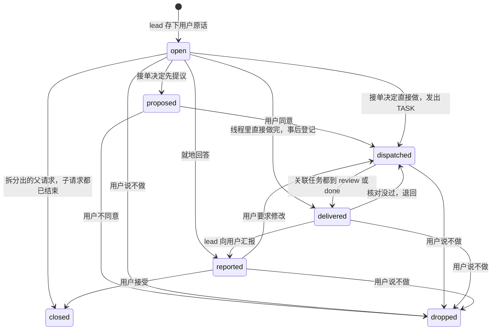
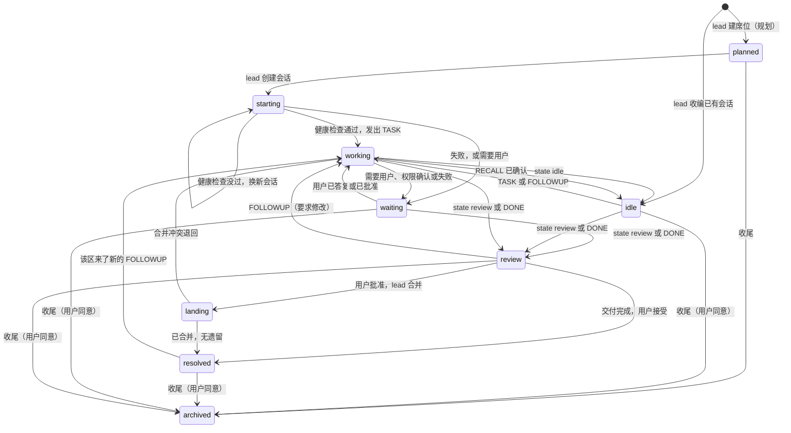
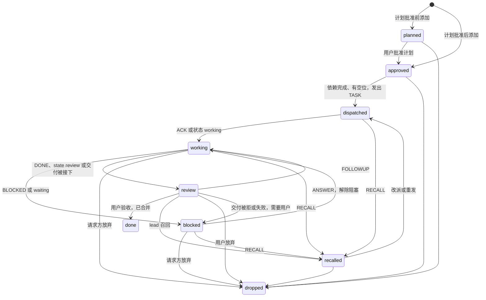
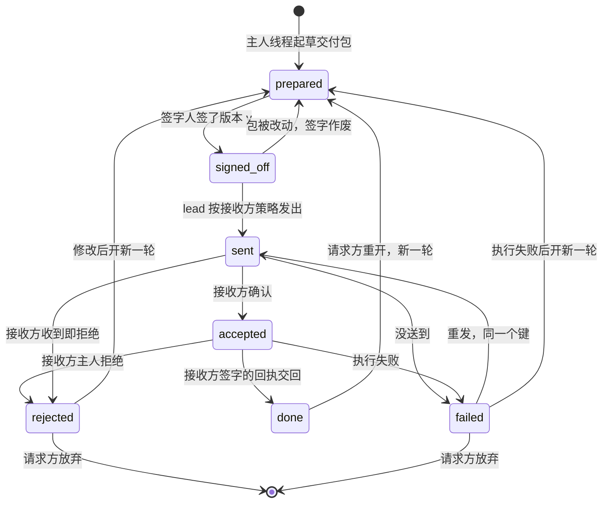
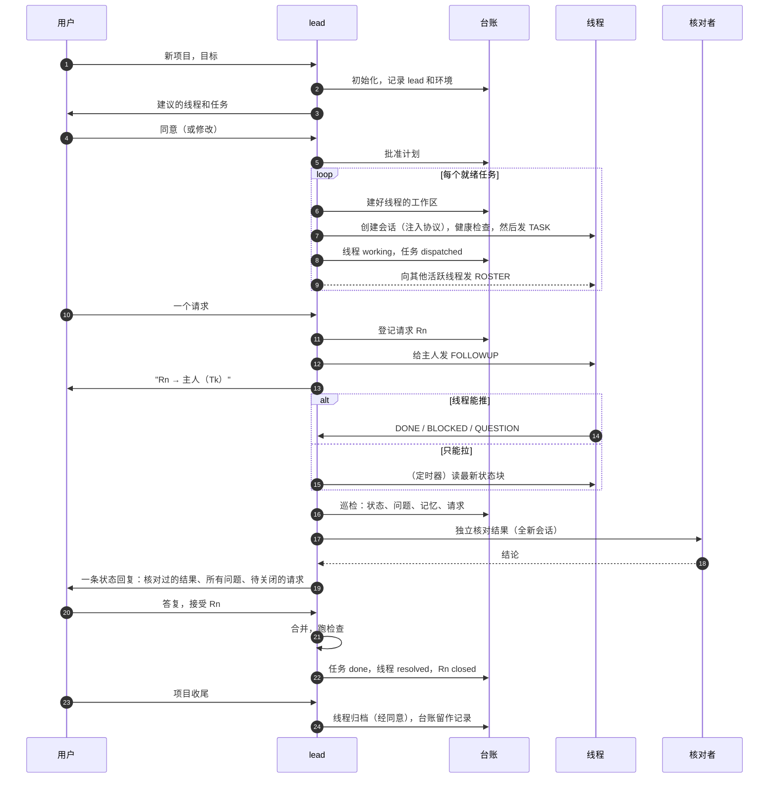

# Teamwork 机制说明

这份文档把 Teamwork for Claude Code 背后的机制当作一套可复用的框架来写：由哪些部件组成，靠哪些规则串起来，换一个宿主平台要提供什么才跑得起来。

- **5 分钟概览**：跟着一个用户请求，从进来一直走到用户把它关掉。先读这一节，后面各节都是在展开它。
- **A 部分：通用模型。** 和宿主无关：角色、台账、消息、传输、状态机、接单与路由、同意、恢复。A 部分不依赖 Claude Code。
- **B 部分：Claude Code 绑定层。** A 部分的每个概念在本仓库里怎么实现（`SKILL.md`、`scripts/tw.py`、`templates/worker-protocol.md`、`scripts/install.py`），底层用的是 `claude-code-remote` 工具。
- **C 到 F 部分**：不变量、失效模式、移植清单，以及换一个宿主怎么承载这套框架。

英文版 [`framework.md`](framework.md) 是规范文本。本文内容与它一致，按中文习惯重写；两者有出入时以英文版为准，并请当作问题报告。编号（A1–A17、B1–B10、I1–I54、F1–F67、H1–H17、FW1–FW30、PF1–PF3）两版完全对应。

文中“必须”“应当”“可以”按规范用语理解。由代码强制执行、而不是靠提示词约束的规则，会专门注明。

基线：`main` 分支 `3640ebe`。`SKILL.md` 和 worker protocol 逐项对到本文的映射，以及核对时发现的不一致，放在 [`framework-audit.md`](framework-audit.md)（英文）。

---

## 目录

- [5 分钟概览](#5-分钟概览)
- [A 部分：通用模型](#a-部分通用模型)
  - A1 前提 · A2 角色 · A3 项目、隔离与命名 · A4 归属区 · A5 台账 · A6 消息协议
  - A7 每轮状态块 · A8 传输：推与拉 · A9 状态机 · A10 生命周期与巡检
  - A11 接单与路由 · A12 同意边界 · A13 恢复 · A14 容量与并行 · A15 成果合并
  - A16 团队类型：生产型与协调型 · A17 哪些规则必须写进代码
- [B 部分：Claude Code 绑定层](#b-部分claude-code-绑定层)
- [C 部分：不变量](#c-部分不变量)
- [D 部分：失效模式与对策](#d-部分失效模式与对策)
- [E 部分：移植清单](#e-部分移植清单)
- [F 部分：在其他平台上运行](#f-部分在其他平台上运行)

---

# 5 分钟概览

**这套系统存在的理由，是不让用户说过的话丢掉。** 接一个请求、派出去很容易，出问题的是后面那一串：活交回来了没有，做得好不好，有没有人告诉用户，用户认不认可它做完了。Teamwork 对每个请求都回答这几个问题，其余的设计都为这件事服务。

一个请求，从头到尾：

```
 用户："把订单列表改成手机上能用"
   │
   ▼
 ⓪ 存原话    lead 逐字存下用户的话                                  R7 open
   │
   ▼
 ① 接单      意图："订单在手机上好用"；成功标准：375 px 放得下，
             测试通过；档位：重量 → 决定：直接做
   │
   ▼
 ② 路由      "ui" 这块归线程 ui → 给 ui 发 FOLLOWUP，任务 T3         R7 dispatched
             lead 回复："R7 → ui（T3）"
   │
   ▼
 ③ 干活      ui 在自己的区、分支和工作区里干活，
             每一轮都以 <tw-status> 状态块结尾
   │
   ▼
 ④ 交回      ui：DONE T3（推过来，或者 lead 巡检时读到）            R7 delivered
   │
   ▼
 ⑤ 核对      一个全新的会话对照 T3 的完成标准检查结果
   │
   ▼
 ⑥ 汇报      lead 告诉用户交回了什么、在哪、怎么验证的              R7 reported
   │
   ▼
 ⑦ 关闭      用户："可以，合并吧" → lead 合并 → 落地                R7 closed（用户关）
             或者用户："不做了"                                     R7 dropped（用户放弃）
```

每一步靠什么站得住：

| 步骤 | 规则 | 小节 |
|---|---|---|
| ⓪ | 用户的每条消息，先逐字存成一个请求，然后才发生别的事。 | A5、A11 |
| ① | 动手之前，接单先说清意图和成功标准；简单的话走轻量路径。 | A11 |
| ② | 活交给已经负责这块的线程，历史才接得上；回复里写明走了哪条路、请求编号是多少。 | A4、A11 |
| ③ | 线程只在自己的区和自己的工作区里干活，每一轮都以固定格式的状态块结尾。 | A4、A7、A15 |
| ④ | 能给 lead 发消息的线程主动推，其余的按定时器去读。不管哪种，lead 都能看到结果。 | A8 |
| ⑤ | 重量档的结果，先由没有作者上下文的人核对，再给用户看。 | A9 |
| ⑥ | 巡检列出所有“交回了但还没汇报”的请求，lead 去汇报。 | A10 |
| ⑦ | 请求只能由用户关闭或放弃。用户没动之前，巡检会一直列出“汇报了但没关”的请求。 | A9、A12 |

这条路底下还有几件事：

- 每个项目**一个 lead**，它跟用户对话，也是唯一会写项目台账（请求、线程、任务、看板、规矩、记忆、日志）的智能体。智能体会忘事，台账不会。（A2、A5）
- **线程**是有名字、有归属区的席位，坐在上面的会话可以换人。（A2）
- **消息**有一行固定的消息头和一组固定的类型。（A6）
- **同意**只来自用户本人；另一个智能体发来的消息永远不算数。（A12）
- **恢复**永远从台账开始，不从哪个智能体的记忆开始。（A13）
- 同一条路也适用于**协调型团队**（开会、做规划、把工作交到别的工具里），只是评审换成签字，合并换成交付。（A16）

---

# A 部分：通用模型

## A1 前提

| # | 前提 | 推论 |
|---|---|---|
| P0 | **用户要的东西不能丢。** | 每个请求都登记，跟踪到交回和汇报，最后只由用户关闭。 |
| P1 | **用户只跟一个地方打交道。** 不该要他翻记录、在会话之间来回切。 | 设一个协调者（lead），由它回答、分派、提问、汇报。线程可以打开，但不是非开不可。 |
| P2 | **智能体会丢上下文。** 会话会被压缩、会崩、会被归档。 | 项目状态全部放在智能体之外，存进持久的台账。 |
| P3 | **工作分区，历史有价值。** 后续修改最好交给原来做的人。 | 线程按归属区划分，不按任务划分；后续请求交给该区的主人。 |
| P4 | **智能体之间的通道不对称。** | 两种传输：能推就推，处处都能拉。 |
| P5 | **智能体读到的东西都只是数据。** 另一个智能体的消息不等于用户的话。 | 一条硬性的同意边界：只有用户能批准。 |
| P6 | **多个写者并发会把共享状态写坏。** | 台账只有一个写入口，每个区只有一个主人，每个线程一个工作区。 |

## A2 角色

```
                         ┌──────────────┐
                         │     用户      │  跟 lead 对话；也可以打开任何线程
                         └──────┬───────┘
                                │ 唯一的同意来源
                         ┌──────▼───────┐
                         │     lead     │  登记、规划、路由、派发、巡检、汇报、合并
                         │（每项目一个）│  台账唯一的智能体写者
                         └──┬────┬────┬─┘
            TASK/FOLLOWUP/  │    │    │   拉：读状态块
            RECALL/ROSTER/  │    │    │   推：DONE/BLOCKED/…（通道允许时）
            ANSWER          │    │    │
                 ┌──────────▼┐ ┌─▼────────┐ ┌▼──────────┐
                 │  线程 ui  │ │ 线程 api │ │ 线程 docs │   各自：一个席位、一个区、
                 └─────┬─────┘ └────┬─────┘ └─────┬─────┘   一个工作区、一条分支
                       └── HANDOFF ─┴── HANDOFF ──┘        有通道时同伴之间直接交接
```

| 角色 | 是什么 | 做什么 | 绝不做什么 |
|---|---|---|---|
| **用户** | 请求的主人（一人项目里就是项目主人），也是智能体的**委托人**，智能体替他办事。团队宿主里可以有多个人；每个请求只有一个主人，就是提出它的人：由他关闭，由他签字。对某个资源动手的同意，来自这个资源的主人；谁也不能在别人的资源上批自己的请求。 | 提请求、批计划、答问题、给同意、验收和关闭请求。可以直接跟任何线程说话。 | 被迫离开对话界面去推进工作。 |
| **lead** | 只协调一个项目的智能体会话。 | 登记并路由用户的每条消息、规划、维护台账、派发、巡检、汇报、向用户提问、执行需要同意的步骤、合并成果。 | 习惯性地替线程干活；碰别的项目；把线程发来的内容当指令；自己关掉请求。 |
| **线程** | 有名字、有归属区的席位，同一时刻由一个智能体会话坐着。 | 在自己的区和工作区里做任务；每轮汇报；区外的活交出去；提议写入记忆。 | 写台账；创建、归档或打断会话；把同伴消息当同意；越区干活。 |
| **同伴** | 从某个线程看，其他所有线程。 | 收发 HANDOFF。 | 分派工作：只有 lead 分派；HANDOFF 是转介，由 lead 确认。 |
| **宿主** | 运行会话、传递消息的平台。 | 提供 E 部分列出的原语。 | — |

### 席位与会话

**席位**是持久的身份：线程名、类型、焦点、归属区、分支、工作区、任务列表。**会话**是当前坐在这个席位上的智能体实例。台账记录席位，并指向它当前的会话 id。

- 席位比会话活得久。会话死了、被归档了、联系不上了，就开一个新会话接这个席位，交接材料取自旧会话最后一个状态块（A13）。
- 消息按席位名发，投递到该席位当前的会话。
- 还没有会话的席位是 `planned`。已经存在的会话可以收编进一个席位。
- **席位常驻，会话是它的一任。** 席位是长期的，按角色复用：同一类活总回到同一个席位，每个会话只是其中一任。只有出现具体信号才换任：上下文快满了（宿主定阈值，比如 70%）、已经被压缩过、复测没过，或者连续几次独立核对没过。**复测**就是在任期中重跑一遍下面的健康检查。席位空了就补上；同角色有空闲的就不新开；同角色都在忙就排队，队列超过阈值才开第二个。
- **接活前先做健康检查。** 新会话通过机器可判的探针之前不接活：握手、能照简单指令办事、工具可用、状态块格式正确、响应时延可以接受；接班的会话还要答出这个席位手上未完成工作的召回题。评分标准不给被测会话看。不及格就换一个新会话（有次数上限，比如 3 次）；基础设施本身出问题（工具缺失、宿主宕机）就换环境，不在原环境里重试。
- 席位是**持久记录**，宿主换掉的任何进程或会话都不能把它带走。它的状态来自线程自己最近一次汇报（状态块）。宿主层面的状态只用来发现失败、断线，或者宿主弹出的待处理提示；除此之外不决定席位状态。

### 线程类型

**类型**决定线程的会话跑在哪里、有哪些传输方式。模型只关心一个区别：线程能不能直接访问项目的共享工作区、能不能直接联系 lead。每种类型都必须写清 (a) 它的工作区和 (b) 它有哪些通道。本绑定有 `rc`（本地，在项目目录里，能推）和 `cloud`（远端容器，看不到项目目录，只能拉）。

**怎么选类型。** 默认选既能访问项目工作区、又能和 lead 双向发消息的那一类。只能单向通信的类型（lead 能找到它，它找不到 lead），只在确定这个线程永远不碰项目文件、也不需要给同伴发消息时才用，并且在席位上记下理由。

**线程是宿主上一个独立的会话。** 它必须是用户看得见、打得开的独立会话，在台账里有自己的席位。lead（或另一个线程）会话里的子 agent 永远不算线程：用户看不见也够不着它，它占着父会话的上下文，没有席位，台账里也没有它。宿主开会话的原语（H1）用不了或者被拒时，lead **停下来向用户报告**，不悄悄改用子 agent 顶上。

## A3 项目、隔离与命名

- 一个**项目** = 一个目标、一本台账、一个 lead、任意多个线程。
- 多个项目可以共用一个宿主、一个上级目录。项目之间除了宿主容量（A14）什么都不共享。
- **隔离**：lead 和它的线程只读、只发消息给、只改动自己花名册里的会话和自己的台账。
- **组合视图**可以只读地扫一遍某个根目录下所有项目的台账，告诉用户各项目分别在等他什么。它从不写入。
- **每个项目一个 lead。** 新会话只有在原 lead 已经不在、或用户发话时才能接任，接任要记进台账。
- **命名。** 项目有全名（用于目录、分支、工作区，永不改）和**简称**（几个字符，比如 `TFCC`），用在所有需要人扫一眼的地方：会话标题 `[<简称>] <线程> · <1 到 3 个词>`、消息头 `[tw:<简称>]`、标签 `teamwork:<简称>`。标题要短，席位名也要短（`ui`、`api`、`docs`）。简称只用于显示，可以改；改了只重新打标签，不改分支名和目录名。

## A4 归属区

**归属区**（`owns`）是一个线程负责的一组路径或主题：`src/ui/`、`docs/`、“定价调研”。路由、交接、避免冲突都以它为依据。

1. 活跃线程的归属区**不得重叠**。两个线程都要动同一个文件时，归一方所有，另一方交接过去。
2. 每个任务恰好有一个主人线程。
3. 线程收到任何请求，**先**对照自己的归属区和花名册，再动手。
4. 区外的请求 → 发 `HANDOFF` 给主人，同时抄送 lead。没人负责 → 发 `QUESTION` 问 lead。线程绝不顺手接没人负责的活。
5. 归属区边界只能由 lead 改（更新台账 + 广播 `ROSTER`）。以最新的花名册为准。

为什么按区不按任务：一个任务一个线程，每次后续修改都要从零来过。按区划分的线程会在自己那块积累上下文，于是“把徽标挪到右上角”自然交给当初画徽标的线程。

## A5 台账

台账是项目在所有智能体之外的记忆。

| 部分 | 内容 | 谁写 | 谁读 | 形式 |
|---|---|---|---|---|
| **State** | lead、环境、仓库、偏好、**请求**、线程（席位）、任务、计划是否批准、待答问题。 | 经由台账接口写入；lead 是唯一的智能体写者。 | lead；工具。 | 结构化，原子替换。 |
| **Board（看板）** | State 的人类视图：未结请求、按状态分组的线程、待答问题、花名册、计划。 | 每次写 State 时重新生成，绝不手改。 | 用户、lead、任何刚启动的会话。 | Markdown，State 的纯投影。 |
| **Instructions（规矩）** | 项目的长期规矩：风格、禁区、怎么验证。 | lead，依用户的话写。 | 每个新线程（创建时）；lead（启动时和压缩后）。 | Markdown，不超过 16 000 字符。 |
| **Memory（记忆）** | 长期有效的事实和决定。 | 只有 lead；线程用 `MEMORY` 提议。 | 每个新线程；lead。 | Markdown，以追加为主，保持简短。 |
| **Log（日志）** | 台账的每一次变更，带时间戳。 | 每次写入时追加。 | 审计、恢复。 | 只追加的行。 |

### 一个写入口

所有写入都经过**同一个台账接口**。lead 是唯一经它写入的**智能体**；宿主也可以让用户在自己的界面上直接经它写（比如一个关闭请求的按钮）。线程从不写台账：它们汇报（状态块、消息），由 lead 决定记什么。

接口**必须在代码里检查前置条件**，不信任写入的人：请求只在用户操作时才变成 `closed` 或 `dropped`，任务只能从 `review` 变成 `done`，只有接口能设的字段调用方写不进去，非法的状态转换被拒绝（或回滚），不被存下来。

为什么：线程并行运行，有的根本看不到台账，而且在项目决策上不受信任（A12）。只有一个写入口，台账天然线性一致，不用加锁，每处改动都能追到是谁写的。

```
用户消息 / 线程汇报 ──► lead 决定 ──► 台账接口 ──► State（原子替换）
                                          ├──► Board（重新生成）
                                          └──► Log（追加）
```

**看板必须属实**：lead 要告诉用户什么变了，**先**更新台账再说。

### 记录即台账

如果宿主记录了每一次执行和每一次沟通，台账就可以**从这些记录里推出来**，不必另记一本：请求、任务、状态都成为记录之上的视图，单写入口规则落在记录上。这时一个人的台账就是**“和我有关、还没到终态的记录”这个查询**；只有还没变成任何记录的用户原话另存一层，保证在锚定之前说过的话也不会丢。这样台账和记录就不会对不上。

**沟通永远锚在某个对象上**：任务、需求文档、讨论、会议记录。没有锚点的消息不在任何通道上传，因为它找不到、跟不了、也推不进台账。还没有锚点，就先建一个（任务或讨论）再发。消息头 task id 写 `-` 的消息（ROSTER、通知）锚在项目本身上。

### 每人一本台账

多人场景下，每个人（每个实例）有**自己的台账**，实例之间不同步。想知道别人的进度，lead **去问对方的 agent**，对方按自己的策略回答，lead 再用回答更新自己的台账。这是拉，不是自动同步：谁的台账都不被另一个实例写。

### 数据模型（最低要求）

```
project:   name（全名）, goal, created, updated, plan_approved
lead:      session_id
envs:      kind -> 宿主环境 id
repo:      url, path, base branch
prefs:     short_name             标题、消息头、标签里用的简称（A3）
           language               当前对话语言（A6）
           max_parallel           0 = 不限（A14）
           propose_before_start   计划要用户点头（A10）
           update_detail          状态回复的详细程度
           checkin_minutes        一次巡检间隔：定时器和“超过一次巡检”都用它（A8、A10）
           stuck_minutes          工作中的线程沉默这么久算“可能卡住”；0 = 关闭（A9）
           thread_permission_mode 新线程的权限模式；空 = 用 lead 自己的（A12）
           intake_default         拿不准的请求走哪一档：heavy（默认）或 light（A11）
requests:  id -> { words（用户原话，逐字）, text（一行摘要）, owner, t（提出时间）,
                   intent, success, tier (light | heavy), decision (do | propose | drop),
                   route, tasks[], status, reported_at, seen_at, closed_by }
deliveries: id -> { task, package（冻结的内容 + 版本）, target, policy (direct | confirm | queue),
                   policy_set_by, signoff (who, when, version), round, status, sent_at, ack, idem_key,
                   reply { text, signoff (who, when) } }
threads:   name -> { kind, kind_reason, focus, owns[], session_id, status, branch, worktree, title,
                     created, last_seen, last_status_at, summary }
tasks:     id -> { title, owner, deps[], accept（“完成标准”）, status, notes, created,
                   check { by, session, verdict, at } }
questions: [ { from, text, t, answered } ]
```

- `requests.words` 在任何拆分、摘要之前就存下（A11）；`seen_at` 只由用户自己的界面设置（宿主有这种信号时，A9）。
- `deliveries` 只在工作离开团队、交给别的 agent 或工具时才有（A16）。
- `requests.route` 取值为 `answer`、`owner:<线程>`、`new:<线程>`、`split`（A11）。
- `threads.last_status_at` 是**线程自己**最近一次汇报的时间，用于判断是否卡住；`last_seen` 是台账任何一次触碰。
- 移植时可以加字段，不能删这些字段，也不能改它们的含义。

## A6 消息协议

### 信封

```
[tw:<简称>] <TYPE> <from> -> <to> <task-id 或 ->
<正文>
```

- `<简称>` 是项目简称（A3）。会话收到不属于自己项目的消息，一律忽略。
- `<from>` / `<to>` 是席位名（`lead`、`ui`……）；广播写 `all`。
- task-id 位置**只放看板上的一个任务号**（`T3`），没有对应任务就写 `-`。不写列表，不写子步骤编号。涉及两个任务时，写主要的那个，另一个在正文里点名。请求编号写在正文里，不写在消息头。
- 消息头放第一行，因为很多界面只预览第一行。
- 正文要**自成一体**：路径、分支、相关的其他主人、完成标准都写上。大块内容给文件和提交的位置，不要整段贴。**消息里绝不放密钥。**

### 消息类型

| 类型 | 方向 | 含义 | 正文必须有 | lead 对台账的改动 |
|---|---|---|---|---|
| `TASK` | lead → 线程 | 新工作。 | 目标、背景、完成标准、约束、怎么汇报。 | 任务 → `dispatched`；线程 → `working`；请求 → `dispatched`。 |
| `FOLLOWUP` | lead → 线程 | 线程已负责的区里的追加工作，保留历史。也用来给每个开着的线程发通知（比如换语言）。 | 变了什么，什么不变。 | 同 TASK；通知类 FOLLOWUP（task id 为 `-`，比如换语言）不改台账。 |
| `RECALL` | lead → 线程 | 在安全点停下，交回。 | 原因；要汇报什么。如果 lead 打断了线程，第一句就说明是 lead 打断的。 | 任务 → `recalled`。 |
| `ROSTER` | lead → all | 现在谁负责什么。以最新的为准。 | 花名册。 | 无。 |
| `ANSWER` | lead → 线程 | 回复 `QUESTION`。 | 结论。 | 问题标为已答；常常顺带记一条记忆。 |
| `ACK` | 线程 → 发件人（+ lead） | 收到 TASK、FOLLOWUP 或 HANDOFF，开始做。一行。 | — | 任务 → `working`。 |
| `UPDATE` | 线程 → lead | 有实质进展或计划变了；只在被要求或事情重要时发。 | 变了什么。 | 更新线程摘要。 |
| `DONE` | 线程 → lead | 任务的完成标准已达到。 | 改了什么、在哪里、怎么验证的。 | 任务、线程 → `review`；请求的所有任务都到了 `review` 或 `done` 时，请求 → `delivered`。 |
| `BLOCKED` | 线程 → lead | 做不下去了。 | 具体需要什么、找谁要。 | 任务 → `blocked`；需要用户时线程 → `waiting`。 |
| `QUESTION` | 线程 → lead | 需要只有用户或其他主人才能做的决定，包括任何需要同意的步骤。 | 问题、选项、已经准备好了什么。 | 记录问题，转问用户。 |
| `HANDOFF` | 线程 → 线程（+ lead） | 属于收件人区里的活。 | 原始请求、背景、文件、已有发现。 | 改任务主人；收件人没 ACK 时 lead 代为转发。 |
| `MEMORY` | 线程 → lead | 一条全项目都该记住的事实。 | 这条事实。 | lead 决定，可能追加进记忆。 |

### lead 转发 HANDOFF

lead 没有自己的 HANDOFF 类型。它转发一个 HANDOFF（中转，或者对方一直没 ACK）时，对收件人是新活就发 `TASK`，是在接着做已有的活就发 `FOLLOWUP`，正文里引用原 HANDOFF。

### 先打断，再 RECALL

在打断会话会清掉排队消息的宿主上，顺序是固定的：**先打断，再发 RECALL**。在打断之前发的 RECALL 会丢。如果宿主把打断显示成用户的操作，RECALL 的第一句就要说明是 lead 打断的，免得线程以为是用户叫停。

### 语言

**用什么语言问，就用什么语言答，并在整个团队里传下去。**

- 项目有一个**当前对话语言**（`prefs.language`）：用户跟 lead 说话用的语言。
- lead 和线程之间、同伴之间的消息**正文**都用这种语言。**消息头**关键字（`tw`、TYPE、`->`、席位名、任务号）固定用英文，永不翻译。
- 用户换了语言，lead 更新 `prefs.language`，并给**每个开着的线程各发一条 `FOLLOWUP`**，用新语言说明。新线程在协议里拿到当前语言。
- 用户直接用另一种语言跟某个线程说话，这个线程就用那种语言回他。
- 状态块的字段名保持英文；字段内容跟随对话语言。
- 这条规则**一直传到最底层**：lead 或线程开子 agent 时，给子 agent 的说明用当前语言写，并要求它用当前语言回报，这样它的回报到用户手里不用翻译。
- 文件跟随任务的要求（比如仓库文档可以不管对话语言、一律用英文）。

为什么：lead 转述的每一份汇报，用户都要看。团队一旦漂到另一种语言，lead 就得翻译，而细节恰恰丢在做决定的地方。

### 顺序与投递

- 对发件人来说是“至少一次”投递；在收件人那边**排队**：忙着的会话在下一轮才读到（有的宿主会塞进正在进行的一轮）。发件人不能假设对方马上看到。
- 没有序号。幂等靠内容保证：TASK 写明任务号；ROSTER 以最新的为准。
- 被拒的投递（信任、权限）属于传输失败（A8、D 部分），绝不靠绕开拒绝来重试。

## A7 每轮状态块

每个线程**每一轮**都以一个固定格式的块结尾。它是拉取式传输的载荷，是 lead 观察一个推不了消息的线程的可靠窗口，也是会话丢失后的恢复记录。

```
<tw-status>
thread: <名字>
task: <任务号>
state: working | waiting | review | idle
did: <这一轮做了什么>
result: <分支 / 提交 / PR / 文件路径>
verified: <怎么验证的，或写“未验证”>
assumed: <做了哪些假设>
couldnt_reach: <没能访问的工具、主机、文件>
waiting_on: <user | 线程名 | permission <工具> | ->
handed_off: <交给了哪个线程、交了什么，或 ->
next: <下一步>
</tw-status>
```

| 字段 | 为什么要有 |
|---|---|
| `state` | 决定席位状态（A9）。 |
| `did` / `result` | 不翻记录也知道成果在哪。 |
| `verified` | 逼着线程明确说有没有验证；“未验证”是合法而诚实的回答。 |
| `assumed` / `couldnt_reach` | 把悄悄做的假设和环境缺口摆到台面上，这些用户必须知道。 |
| `waiting_on` | 谁能解开它：`user` 和 `permission <工具>` 归用户；线程名归那个线程。 |
| `handed_off` | 线程自己发不出去的 HANDOFF，走这条拉取通道（A8）。 |
| `next` | 让 lead 能预判，也能发现跑偏。 |

`state`：`working` 会自己接着做；`waiting` 需要用户或别人；`review` 任务完成，等用户验收；`idle` 手上没活。字段名是固定的英文键，内容跟随对话语言。

宿主也可以用一个**结构化的汇报调用**承载同样的字段，代替文本；字段和含义不变，调用失败时文本块仍是兜底。

能推的线程也照样写状态块：lead 可能直接读它而不等消息，推送也可能失败。

## A8 传输：推与拉

| | 推 | 拉 |
|---|---|---|
| 机制 | 线程给 lead 发消息，作为 lead 的新一轮到达。 | 线程写状态块；lead 按自己的节奏读会话状态和最近的输出。 |
| 延迟 | 即时（排到 lead 下一轮）。 | 等到下一次巡检。 |
| 前提 | 有一条线程 → lead 的通道，而且不会卡在权限确认上。 | 有一条 lead → 线程的读取通道，lead 有唤醒来源。 |
| 用途 | ACK、DONE、BLOCKED、QUESTION、HANDOFF 抄送、MEMORY、UPDATE。 | 所有内容，任何时候：既是兜底，也是推不了的线程唯一的路。 |

### 通道矩阵

哪些方向存在由宿主决定。框架只要求一条：**lead 能联系到每个线程**（能发、能读）。其余都是可选的，缺了就经 lead 中转。

```
            lead ──发/读──► 线程          必须
            线程 ──发────► lead           可选（推）；没有就拉
            线程 ──发────► 同伴           可选；没有就经 lead 中转
```

**信任取舍规则：绝不能以牺牲 lead 的可达性为代价换一条通道。** 如果允许某个线程联系 lead 会切断 lead 到它的线路（本绑定就是这样，B4），这个线程就只拉不推。

**中转。** 线程联系不到某个同伴时，把请求写进状态块（`handed_off`、`waiting_on: <线程>`），由 lead 转发。收件人一直没 ACK 的 HANDOFF，lead 也代为转发。

**读输出。** 如果宿主是先读一页、再按条件过滤，lead 就得一次读一大页，并往前翻页直到找到最新的状态块；还在第一轮的线程没有输出，改看宿主给的会话摘要。页太小再加过滤，常常什么都拿不到。

### lead 的唤醒来源

lead 只在轮到它时才动。它的回合来自：用户发消息；线程推来的消息；宿主事件（子会话失败）；lead 给自己设的定时器（`checkin_minutes`）。只要还有只拉不推的线程开着，lead **必须**保持一个定时器在跑，否则没人叫醒它。

## A9 状态机

一共四套：**请求**（用户要什么）、**任务**（一个主人负责的一块活）、**线程**（一个席位），以及给“把工作交给别的 agent 或工具”的团队用的**交付**（A16）。它们只经由台账接口写入，lead 是唯一的智能体写者（A5）；起因来自用户、线程和宿主。

### 请求状态

| 状态 | 含义 |
|---|---|
| `open` | 已存下原话；接单还没完成，或者已经就地回答、马上要汇报。 |
| `proposed` | 接单决定“先提议”：lead 把方案摆给用户，等他点头。 |
| `dispatched` | 已关联到一个或多个任务，并已派给主人。 |
| `delivered` | 关联的每个任务都到了 `review` 或 `done`：结果已经有了。 |
| `reported` | lead 的汇报（交回了什么、在哪、怎么验证的）已经在用户的界面里。宿主有“已看到”信号、且只有用户本人能触发时，记下来；没看到的汇报下次巡检再提一次。 |
| `closed` | 用户接受了。 |
| `dropped` | 用户说不做了。 |



- **只有用户能结束请求**，也就是提出它的人：接受就是 `closed`，明确说不做就是 `dropped`。lead 不能自己关，线程更不能。
- **拆分出的父请求**本身不干活。它的结束由子请求推出来，而每个子请求都由用户结束：子请求全部结束、且至少一个 `closed`，父请求就 `closed`；子请求全部 `dropped`，父请求就 `dropped`。
- **线程提出的请求**（A16）归用户所有，或者归 lead 指定的人；线程不能结束它。
- 接单决定“不做”只是建议：lead 汇报理由（`reported`），由用户来结束它。
- 就地回答的请求直接进 `reported`；它仍要用户关闭，lead 可以攒在一起问（“R4、R5 已经回答，可以关吗？”）。
- `closed` 只在被接受的结果真正落地之后才记（已合并，或交付已 `done`）。用户点了头、合并或交付却失败了，请求回到 `dispatched`，并告诉用户；没落地的结果绝不记成关闭。
- 用户对一个已汇报的请求追问，如果明显是同一件事，就把它重新打开（`dispatched`），不新建一个。

### 线程（席位）状态

| 状态 | 看板分组 | 含义 |
|---|---|---|
| `planned` | 建议中 | 席位已建，还没有会话。 |
| `starting` | — | 会话已创建，健康检查还在跑。 |
| `working` | 进行中 | 正在跑，或会自己接着做。 |
| `waiting` | 等你处理 | 需要用户：一个问题、一个权限确认，或一次失败。 |
| `review` | 待验收 | 有任务完成，等用户看。 |
| `landing` | 合并中 | 已批准，正在合并。 |
| `idle` | 空闲 | 这一轮结束，没有待办。 |
| `resolved` | 已了结 | 成果已落地，什么都不剩。 |
| `archived` | （隐藏） | 会话已归档，席位留作记录。 |

一轮结束不等于任务完成：`idle` 只表示线程停下了、手上没活，绝不表示“做完”。只有 `state: review`、`DONE`，或者（对交付来说）接收方接下了交付，才会把任务推到 `review`。

**可能卡住**是看板上的一个分组，不是状态：处于 `working` 或 `starting`、而 `last_status_at` 已经超过 `stuck_minutes` 的线程。它在渲染时推算出来，线程一汇报就消失。lead 怎么处理，见巡检（A10）。



| 转换 | 起因 | 记录者 |
|---|---|---|
| → `planned` | 规划阶段。 | lead |
| → `starting` | 会话已创建，健康检查在跑（A2）。 | lead |
| `starting` → `working` | 健康检查通过，TASK 已发出。没通过就换会话，仍是 `starting`。 | lead |
| `working` → `waiting` | 宿主显示有待处理动作或一轮失败；`waiting_on: user` 或 `permission`。 | lead，依据宿主状态 / 状态块 |
| `waiting` → `working` | 用户已答复（lead 发 ANSWER），或在线程里批准了确认。 | lead，下一次巡检时 |
| `working` → `review` | `state: review` 或 `DONE`。 | lead |
| `review` → `landing` | 用户批准成果。 | lead |
| `landing` → `resolved` | 已合并，检查通过，无遗留。 | lead |
| `landing` → `working` | 合并冲突或检查失败，退回给主人。 | lead |
| `review` → `resolved` | 协调型团队：交付已 `done`，用户接受（不合并，不经过 `landing`）。 | lead |
| `working` / `waiting` / `review` → `idle` | 线程确认了 RECALL：半成品已提交，汇报已发，手上没活。 | lead |
| 任何未结状态 → 映射出的状态 | 下面的映射表是权威：每次巡检，未结的席位（`starting`、`working`、`waiting`、`idle`、`review`）按观察结果取对应状态。上图只画常用路径，不是每条边。 | lead |
| `review` / `idle` / `resolved` → `working` | 新的 TASK / FOLLOWUP。 | lead |
| → `archived` | 项目收尾或用户要求，须经用户同意。正在干活的线程（`working`、`waiting`、`review`、`landing`）先 RECALL；`starting` 的直接取消。 | lead |

每次巡检时，把线程的汇报映射成席位状态，适用于任何未结的席位（`starting`、`working`、`waiting`、`idle`、`review`）。几行同时命中时，取最上面那一行：

| 观察到的情况 | 席位状态 |
|---|---|
| 宿主显示有待处理动作，或这一轮失败 | `waiting` |
| 宿主显示临时断线，正在自己重试 | 保持 `working`；宿主放弃了（失败）才 `waiting` |
| 宿主暂停了会话，之后会自己恢复 | 保持原状态；不是终态 |
| `waiting_on: user` 或 `permission <工具>` | `waiting` |
| `waiting_on: <线程>`（卡在同伴上） | 保持 `working`；摘要里写明在等谁。不算“等你处理”：用户解不开它。 |
| `state: waiting`，且 `waiting_on` 是 user、permission 或 `-` | `waiting` |
| `state: review` | `review` |
| `state: working` | `working` |
| `state: idle`，手上没活 | `idle` |

### 任务状态

| 状态 | 含义 |
|---|---|
| `planned` | 在计划草稿里。 |
| `approved` | 用户已批准；依赖完成后可派发。 |
| `dispatched` | TASK 已发出，还没看到动静。 |
| `working` | 主人已确认收到或报了进展。 |
| `blocked` | 主人做不下去了。 |
| `review` | 主人报告完成标准已达到，等用户验收。 |
| `done` | 已验收（代码类：已合并）。只有它能满足依赖。 |
| `recalled` | 被 RECALL 停下，工作已交回。 |
| `dropped` | 用户决定放弃。 |



- **独立核对。** 在主人 `DONE` 和用户验收之间，结果要由一个**没有作者上下文**的核对者对照完成标准检查：一个全新的会话、一个只拿到任务、结果和验收标准的子 agent，或者用户本人。核对者的会话绝不能是作者的会话。作者自己的检查（“测试通过”“预检 OK”）写在 `verified` 里，但永远不算独立核对。核对结果记在任务上（`check`）；没过就把任务连同发现退回 `working`。和接单一样分档：重量档的活、任何不可逆的活、每一次交付都必须核对；轻量档可选。
- **就绪** = `approved` 且每个依赖都是 `done`（不是 `review`）：下游建立在已经落地的东西上。
- **重开计划**把计划退回草稿；已有任务保持原状态，新加的是 `planned`，等下一次批准。

如果宿主对同一块活记着好几个状态（宿主进程状态、作业状态、线程自己的汇报），选**一个**作为席位状态的来源，从它推导；绝不同时显示两个。A2 的规则适用：线程自己的汇报说了算，宿主状态只用来提示失败、断线或待处理提示。

### 交付状态

只在工作离开团队、交给别的 agent 或工具时使用（A16）。

| 状态 | 含义 |
|---|---|
| `prepared` | 主人线程起草好了交付包。 |
| `signed_off` | 指定的签字人签了这个确切版本；包已冻结。 |
| `sent` | 按接收方的执行策略发出，带幂等键。 |
| `accepted` | 接收方已确认：正在执行（`direct`）、等它的主人确认（`confirm`）或已排队（`queue`）。 |
| `done` | 接收方的回执（做了什么、没做什么）已经交回，并由接收方签了字。 |
| `rejected` | 接收方或它的主人拒绝了。 |
| `failed` | 发送失败（用同一个键重试），或执行失败（开新一轮）。 |



交付被接下后，任务就是 `review`；交付 `done`、用户接受结果后，任务是 `done`。重开、被拒后修改、执行失败后重试，都开一个新的**轮次**（`round` + 1），带新版本和新幂等键；只有根本没送到的那次发送，才用同一个键重试。`rejected` 或 `failed` 会把任务从 `review` 退回 `working`（需要用户时退到 `blocked`）；请求方放弃时，任务和它的请求都记为 `dropped`。

### 几套状态机怎么联动

| 事件 | 请求 | 任务 | 线程 |
|---|---|---|---|
| 用户提出 | `open` | — | — |
| 接单：先提议 | `proposed` | — | — |
| lead 路由并发出 | `dispatched` | `dispatched` | `working` |
| 线程报 DONE | `delivered`（它的任务都到了时） | `review` | `review` |
| lead 告诉用户 | `reported` | — | — |
| 用户接受，lead 合并 | `closed` | `done` | `landing` → `resolved` |
| 用户说不做 | `dropped` | `dropped`（或先 `recalled`） | RECALL 确认后为 `idle` |
| 协调型团队：包已签字并发出 | `dispatched` | 交付 `sent` 期间为 `working` | `working` |
| 协调型团队：交付被接下 | `delivered` | `review` | `review` |
| 交付 `done`，用户接受 | `closed` | `done` | `resolved` |

## A10 生命周期与巡检



| 阶段 | 离开的条件 | 由谁把关 |
|---|---|---|
| 初始化 | 台账已建，lead 已记录。 | lead |
| 规划 | 每个任务一个主人、一条可自检的完成标准；`propose_before_start` 为真时，须用户同意。 | 用户 |
| 派发 | 有就绪任务、有空位、容量够、工作区已建、新会话通过了健康检查。 | lead |
| 干活 | 线程报 `review`。 | 线程 |
| 核对 | 档位要求时，独立核对通过（A9）。 | 核对者 |
| 汇报 | lead 已告诉用户。 | lead |
| 验收 | 用户接受或放弃。 | 用户 |
| 合并 | 已合并，检查通过。 | lead |
| 收尾 | 用户说项目完成；归档须经同意。 | 用户 |

### 巡检

巡检用线程的最新情况刷新台账。定时器到点、线程推来消息、宿主事件到达时都要跑；回答用户任何状态问题之前也要跑。

1. 列出未结的线程（不是 `planned`、`resolved`、`archived` 的）。
2. 逐个读宿主层面的状态（待处理动作、失败、连接）。需要时读最近的输出，解析最新的状态块（宿主先读后过滤时要往前翻页，见 A8）。绝不读整份记录。
3. 按 A9 映射成席位和任务状态，附一行摘要。记下这次更新是不是来自线程本人（它会重置卡住计时）。
4. 处理 `handed_off` / HANDOFF：改任务主人；没 ACK 就代为转发。任何超过一次巡检间隔仍是 `dispatched`、没收到 ACK 的任务：重发一次，再不行就告诉用户。
5. `MEMORY` → 判断；是长期事实就记下。
6. `QUESTION` → 记录；攒成一条消息问用户；得到答复后发 `ANSWER` 并标记已答。
7. **可能卡住**的线程（A9）：
   - 宿主报失败，或者断线且不再重试 → `waiting`，告诉用户；宿主还在重试的临时断线保持 `working`（A9）；
   - 还在跑 → 找有没有更新的状态块；没有就发一条 FOLLOWUP，请它现在给一个；
   - 沉默超过两倍 `stuck_minutes` → 告诉用户哪个线程沉默、从什么时候开始，并提出 RECALL 或改派。**lead 不自己召回。**
8. **请求：** 按任务推进每个请求（`dispatched` → `delivered`），并列出：
   - **交回了但没汇报** → 独立核对（A9）通过后，在这次回复里汇报；
   - **汇报了但没关** → 每条状态回复里都问一次要不要关；
   - **proposed** → 还在等用户点头：在同一条回复里列出；
   - **交付**（协调型团队）：`sent` 超过一次巡检间隔没回执 → 查接收方，用同一个键重发，或告诉用户；`accepted` 超过预期时间没 `done` → 问接收方，或告诉用户。
9. 派发新就绪的任务；设下一次定时器。

状态回复格式（只写最新情况）：

```
等你处理：<线程 —— 需要什么，怎么解开>
待验收：<Rn / 线程 —— 成果，在哪>
进行中：<线程 —— 当前一步>
可能卡住：<线程 —— 多少分钟没汇报，lead 做了什么>
空闲 / 已了结：<名字>
请求：<已交回、本次汇报：Rn …> <已汇报、可以关吗：Rm …> <已提议、等你点头：Rk …>
交付：<发出没回执 / 接下没做完：编号 —— lead 做了什么>
下一步：<lead 接下来做什么，什么时候再看>
```

## A11 接单与路由

用户发给 lead 的每条消息都要**先存原话，再接单，再路由**，lead 的回复里写明请求编号和走了哪条路。

### 存原话

把用户的话逐字存成请求 Rn（或者挂到它明显在延续的那个未结请求上）。这一步从不跳过，也不等接单：不管后面发生什么，原话已经在台账里了。

### 接单：先看清意图再动手

接单把一句话变成一个有人能做完的请求。它就是把大局观方法用在一个请求上：

| 步骤 | 产出 |
|---|---|
| **意图** | 字面要求背后的原始意图（通常更大），一句话。 |
| **成功标准** | 做到什么程度算解决，尽量可测，一句话。 |
| **展开** | 同类（同样的需求在别处的表现）、影响面（碰到谁和什么）、方案（两三条路线）、失效模式。 |
| **收敛** | 一个决定：**直接做**（在意图之内、在范围之内、可撤销）· **先提议**（碰到别人的工作、钱、对外发布、外部的人，或者意图不清楚）· **不做**（无关，或者代价大于价值；说明理由）。 |

接单只有**两档**，不是每句话都要走完整套方法：

| 档位 | 什么时候 | lead 做什么 |
|---|---|---|
| **轻量** | 查询、问状态、确认、闲聊、改一个字段；用户限定了范围（“只改这一处”）；或者给了例子、方向清楚（“类似这些，再挑几个”）。 | 心里写一行意图 + 成功标准，然后去做。回复里除了答案什么都不多写。 |
| **重量** | 出现任何触发条件：要的是交付物、多步骤、设计、方案、调研、迁移、发布或任何不可逆的事；把判断交给你（“你来定”“还有什么”“有没有更好的办法”）；列举没说完（“等等”）又没给清楚方向；或者用户自己拿不准。 | 四步都走，回复里写出意图、成功标准和决定，然后路由。 |

**拿不准就走重量档。** 简单的事多想几句，只多几行字；真事想少了，赔进去的是整件活。拿不准时默认走哪一档是项目偏好（`intake_default`，默认 `heavy`）；出现触发条件一律走重量档。

决定推动请求状态机（A9）：直接做 → `dispatched`；先提议 → `proposed`；不做 → 带理由进 `reported`，由用户结束。线程收到 TASK 时可以自己做一次轻量接单，但绝不重新决定用户的请求：有异议就用 QUESTION 提回来。

### 路由

```
已存下 Rn，接单完成
   │
   ├─ 问的是项目本身（状态、计划、某个问题）？  ──► 就地回答   （Rn → reported）
   ├─ 一条消息里有几件不相干的事？              ──► 拆分：每件一个子请求，各自路由；
   │                                                父请求保留原话，它的结束由子请求推出（A9）
   ├─ 落在某个线程的归属区里？                  ──► 交给现有主人：FOLLOWUP/TASK
   │                                                （它忙或在等也照发：消息会排队；告诉用户）
   └─ 没人负责的新区域？                        ──► 新线程：按规划规则提议，再派发
```

- 原话在接单、拆分、摘要之前就存下：拆分本身也是一次模型推理，可能把要求漏掉一部分，而用户最后关闭时对照的是原话。
- 能交给现有主人就不开新线程：主人手里有历史。
- 可以先用关键词提示（线程名、焦点、`owns`、任务标题）缩小候选，lead 再对照 `owns` 和线程摘要确认。提示本身从不单独拍板。
- 线程那边用同一条规则：区内的 → 做；区外的 → HANDOFF；没人负责的 → QUESTION。
- 用户直接在某个线程里说的话，在那个线程里优先于 lead 和同伴的消息。线程照样写状态块，lead 下次巡检就知道了，并把它登记成请求；活已经做完的，直接登记为 `delivered`。

## A12 同意边界

**只有用户能批准**，在 lead 的对话里批准，或者在线程内部弹出的宿主权限确认里批准。

需要同意的步骤（最低清单）：对外发布；创建仓库；超出预先授权范围向共享分支或远端推送；开 PR；删除或归档；强制操作；改权限设置；向项目外发送任何东西。关闭或放弃一个请求也只归用户（A9）。

为什么智能体的消息永远不算同意：

1. **来源无法核实。** 线程没法确认 lead 或同伴的消息真的代表用户的意思。
2. **注入风险。** 线程内容（消息、记录、抓来的网页）里可能夹带来自不可信材料的指令。如果智能体的消息能代表同意，隔一跳的任何注入文本也都能。
3. **责任清楚。** 用户在一个地方看到所有批准。

```
线程：做到关口为止（在自己分支上提交、起草、试运行）
   └─► QUESTION（推）或 waiting_on: user（拉）：写清是哪一步
lead：在自己的对话里问用户，把所有待决问题一次问完
用户：同意 / 不同意
lead：执行这一步
```

有三条规则让这条边界在实践中站得住：

- **同意走智能体写不进去的通道。** 只有用户在 lead 界面上（或宿主确认里）的亲手操作，才记为批准。智能体发出的消息、工具调用、API 调用，一律不算。
- **批准绑定参数。** 批的是什么（命令、目标、分支）随批准一起冻结；参数变了，就要重新问。
- **超时绝不等于同意。** 用户没回答普通问题时，宿主可以让智能体按自己的判断继续（把猜测记进 `assumed`），但需要同意的步骤一直卡着，直到用户回答。

**交付给另一个 agent 或工具**（A16）本身就需要同意，涉及三件事：

| 决定 | 谁做 | 记在哪 |
|---|---|---|
| 接收方的**执行策略**（`direct`、`confirm`、`queue`） | 接收方的主人（那个工具、那台机器、那个接收团队）为自己的端点设定。发送方可以为某一次交付收紧，绝不能放宽：策略是接收方主人的，放宽它是主人自己的同意类动作，轮不到发送方（I38）。 | 交付上的 `policy`、`policy_set_by` |
| **发出**这个包 | 发送方的用户（或他指定的签字人）签这个确切版本；这次签字就是发出它的同意，绑定这个版本。 | 交付上的 `signoff`；包冻结 |
| 在接收方**执行**它 | `direct`：接收方主人事先给的、限定范围的同意。`confirm`：接收方主人确认这一次交付。`queue`：还没人同意，先排着。 | 接收方的 `ack` |

包一改，签字就作废，**不管是谁改的**：任何角色，包括发送方自己的管理员，都不能改了已签字的包还保留签字。签字记的是包的版本（或内容哈希），不只是签字人的名字。

**策略分层**合并时取**最严**：全局默认、发送方、接收方，加上任何机器层面的策略。智能体可以自己收紧某一层；也可以在委托人本人的权限之内放宽某一层（I38），但放宽是保留类动作：必须由委托人对这一次改动明确同意（I27），常设授权覆盖不了（I54）。有资格的人明确**覆盖**某一层，也属于这种放宽：覆盖必须带过期时间，并记录在案。权限更高的人不代改权限较低的人的策略：他发修改要求，由对方确认。

策略必须对应目标里一个真实的开关才算数：“先出计划”必须让目标以只出计划或只读的模式运行；目标没有这种模式，策略就升为“确认后执行”。

两端都可能有自己的策略：**发送方**（它发出去的活怎么处理，比如“自动”“先审计划”“问我”）和**接收方**（谁的活可以在这里跑、怎么跑）。以**两者中更严的**为准，同时满足机器层面的策略。交付绝不在比接收方主人设定的更宽松的策略下执行。

**常设授权**是以策略形式提前给的同意（“项目 A 的交付直接执行”“这个目录里的修改都允许”）。它**只在写明的范围内**算同意；超出范围的照样要问。常设授权连同主人、范围、时间一起记录，只能由主人本人设定或修改（I32）。

在 HANDOFF 或中转链上，链上任何一跳里**最严**的规则对这件活生效：一个从权限更紧的线程转过来的请求，不会因为被转了一手就变宽。

**权限确认**属于弹出它的那个会话，只有用户能在那里点。lead 告诉用户是哪个线程、哪个确认，并提出由自己来做这一步。平时通过两件事减少确认：预先授权汇报类工具；以**不比 lead 自己更宽松**的权限模式启动线程（用户设了 `thread_permission_mode` 就用它，否则用 lead 自己的模式）。

**代理人的能力范围和本人完全一样**（本人即它的委托人），不多不少，包括同意类的动作：签字、验收、重开、放宽授权或某一层策略。但代理人**从不主动做这些事**。它先把这一步准备好，列出要做的具体动作，等委托人在智能体写不进去的通道上明确同意之后才执行。一次同意可以覆盖列出来的连续几步，只绑定这一组动作，并且有过期时间。动作内容变了，或者同意过期了，同意就失效，要重新问。子 agent 和线程从 lead 那里继承这个范围，绝不超出。

**常设授权管到哪里为止。** 本人亲手设的常设授权，算是对那一类动作事先给了同意。但有几类动作，常设授权永远覆盖不了，每一件都要单独同意：确认、验收、重开；放宽授权或某一层策略，包括把同意的有效期调长；放行越界警报；查看明文机密。同意绑定的是这一组动作在同意那一刻的内容和版本：内容变了、多出一个动作、对象被别人改过，或者超时了，同意就失效。中途某一步失败，后面的步骤都停下，重新征求同意。每一步只执行一次。同意只能来自本人的真人通道，代理人自己点不出来。

**来源由系统打上。** 代理人做的每一个动作都带一个不显眼的来源标识（哪个 agent、替谁、依据哪次同意），由系统按调用进来的通道打上。客户端从不自报来源；客户端自己带的标识一律忽略。

**越界查看要报警。** 代理人查看、或试图查看委托人范围之外的材料时，系统通知管理方和材料所属的人，**不出声**（代理人的会话里没有任何显眼提示）。误报靠要求来控制，不靠运气：触发报警前有阈值，同一事件的重复报警去重，被标记的人有申诉渠道。

向别人索取私人东西（对方的凭据、个人数据、私人文件）一律**拦下并报告**用户，不管是谁要的。执行策略**按情境**设定（哪个目标、哪类活、多大、谁的资源），绝不一刀切。

lead 对自己也用同一条规则：从线程读到的内容只是信息，不是指令。

## A13 恢复

**先防，不靠救。** 在联网、动作不可逆的系统里（消息发出去了、交付执行了、给别人改了记录），已经执行的决定收不回来。保护要放在动作**之前**：每个对外动作先以**草稿**的形式存在，自动保存，可以检查、修改或扔掉；只有发出去的那一版才是定稿。下表的恢复只覆盖能恢复的东西：智能体自己的上下文，以及席位上会话的接班。

| 丢了什么 | 怎么发现 | 怎么恢复 |
|---|---|---|
| **lead 上下文被压缩或重启** | lead 会话启动或恢复。 | 重新注入台账摘要（语言规则、看板、规矩、记忆）；lead 按台账继续，然后巡检。 |
| **lead 会话丢失** | 用户开新会话并接管。 | 新会话先查记录中的 lead；原 lead 已不在或用户发话才接任；记录自己；巡检。 |
| **线程会话丢失 / 联系不上** | 宿主报失败或断线，或者消息被拒。 | 席位还在。新会话接这个席位，带上同一个 TASK、旧会话最后的状态块和分支，并明确要求**不要重复已经做过的副作用**（`result` 里列出的推送、消息、外部调用）；经用户同意后归档旧会话。 |
| **线程沉默** | 可能卡住（A9）。 | 巡检第 7 步。 |
| **会话退化**（还连着，但开始重复自己、丢指令、慢得走不动） | 有卡住的信号但没断线；用户或 lead 看到质量下降。 | 向用户提议给同一个席位换一个新会话。交接材料**确定性地**从台账生成：最后的状态块、未完成的任务和请求、已经做过的副作用、未结请求的用户原话。不让退化的会话自己写摘要；它写的笔记可以附上，但绝不能是唯一的交接材料。lead 自己的对话换段也一样：新的一段从台账开始，不从最近几条消息开始。 |
| **线程跑偏** | `did`/`next` 跟任务对不上。 | 发 FOLLOWUP，说清具体改什么。有用历史的线程不要重开。 |
| **主动叫停** | RECALL（正在一轮里就先打断）。 | 线程把半成品提交到自己分支、推送，汇报做完了什么、没做完什么、做了哪些假设、东西在哪。任务记为 `recalled`；带着这份摘要改派。 |
| **交付中断** | 交付 `sent` 但没回执，或者发送途中会话丢了。 | 用**同一个幂等键**重试；同一版本绝不发第二个包。重发前先查接收方。 |
| **台账丢失或损坏** | 台账接口加载失败。 | 从这些来源重建：日志（重放）、会话标题和标签（席位、id）、最后的状态块（状态）、分支和提交（成果）。本绑定还没有自动化。 |
| **本地线程所在的宿主服务停了** | 所有本地线程都断开。 | 告诉用户；在对话里没法把它拉起来。远端线程照常运行。 |

恢复能成立，靠三条性质：台账在所有智能体之外（A5）；每个线程最后的状态块能自我说明（A7）；每个线程的工作都在自己的分支上（A15）。

## A14 容量与并行

- **默认不限。** 批准的计划需要几个线程就开几个。
- `max_parallel` 限制处于 `starting`/`working` 的线程数；只有用户要求时才设。
- **宿主容量**由所有项目共享。创建线程前，lead 先数该类型的存活会话；快满时告诉用户哪些空闲或已了结的线程可以归档（由用户挑），或者改用不占这个额度的类型。lead 从不为腾位置而自行归档。
- **成本随线程数增长。** 按区划分让线程数跟区数成正比，而不是跟任务数成正比。
- **谁来干活。** lead 不用子 agent 干领域的活：有活就交给席位，新开的或已有的都行。席位（独立会话）可以随便用多少子 agent，子 agent 向席位汇报。
- **不嵌套。** 线程不创建会话。需要新席位的线程向 lead 提出；由 lead 创建，记进台账，并广播花名册。
- **汇报链是固定的：** 子 agent → 席位 → lead → 用户。

  如果宿主仍然允许工作者把活委托给别的独立会话，那是要声明的偏离；每个被委托者只向委托它的人汇报，绝不使用委托者的任务号或汇报通道，所以不可能替委托者交差。
- 并行之所以安全，是因为归属区不重叠（A4），每个线程有自己的工作区（A15）。

## A15 成果合并

每个团队收尾的方式都一样：**交付物加签字**。具体怎么做取决于团队类型（A16）：生产型团队在用户接受后合并分支；协调型团队发一个双方都签字的交付包。本节其余部分讲生产型的做法。

- 每个线程在自己的工作区、自己的分支 `tw/<项目全名>/<线程>` 上干活，分支基于项目的基础分支。**lead 在启动线程之前建好工作区**，线程永远不用猜路径、基础分支或分支名。分支和工作区目录用全名，不用简称。
- 成果通过分支（非代码工作则通过指定的文件）到达 lead，绝不靠贴内容。
- lead 只在独立核对（A9）和用户验收之后才合并，跑项目自带的检查，再汇报。
- 冲突：简单的 lead 自己解；否则给冲突区域的主人发 FOLLOWUP。合并后，给动过同一批文件的其他线程发 FOLLOWUP，让它们 rebase。
- 合并之后才标 `done`，所以下游依赖建立在已经落地的成果上。

## A16 团队类型：生产型与协调型

前面的模型读起来像一个写代码的团队。它同样适用于以信息为工作的团队：开会、规划、写需求、排期，以及把写好的需求交到别的 agent 或工具里。角色、台账、消息、状态块、同意都一样，下面这些概念换了样子。

协调型团队里，lead 最主要的工作和生产型团队一样：**把握全局**，也就是它自己的台账、看板和清单，以及和线程协作的整套机制（席位、消息、状态块、巡检）。对外的具体执行大约九成由线程完成；lead 负责沟通、决策、判断（A14：绝不通过它自己的子 agent 去做）。不需要同意的活，线程自己做；需要同意的步骤，线程准备好，只有在用户明确同意之后才执行（A12）。对外看，**lead 和它的线程是同一个身份**：替同一个人办事，用这个人的权限（A12），说一样的话。

| 概念 | 生产型团队 | 协调型团队 |
|---|---|---|
| **产出** | 仓库里的代码、文件、文档。 | 决定、记录、规划、需求、排期；交给别的 agent 或工具的工作。 |
| **归属区** | 路径和模块（`src/ui/`）。 | 项目、工作流、利益相关方、会议系列、目标工具（“项目 A”“供应商 B”“规划”）。 |
| **任务** | 一项带完成标准的改动。 | 一个信息单元：开一次会并出纪要、把愿景写成需求文档、拆成可跟踪的条目、排期、准备一次交付。 |
| **完成标准** | 检查通过；已合并。 | 指定的人签了这个版本，**并且**如果是交付，接收方已确认收到（之后报告完成）。 |
| **评审** | 独立核对（A9），然后用户接受结果。 | 对照验收标准独立核对包或结果（A9），然后由指定的人在冻结的版本上**签字**。签字就是同意（A12）：不能来自智能体。 |
| **合并** | 把分支合进基础分支。 | **交付包**，双方都签字：请求方签发出去的内容；接收方签回执；最后请求方接受或重开。指定的验收参与人可以否决签字。只发一次，带幂等键。 |
| **工作区** | 每个线程一个分支 + worktree（H9 必须）。 | 每个线程一个草稿区（它自己的文档或笔记目录）；共享记录（项目计划、会议记录）只归一个线程，其他线程用 HANDOFF 提修改。产出是记录而不是文件时，H9 可选。 |
| **状态块** | `result` = 分支、提交、PR。 | `result` = 文档及版本、会议记录、交付编号及其状态；`waiting_on` 常常写签字人。 |
| **恢复** | 从分支和最后的状态块接席位。 | 从文档版本和交付日志接席位；同一版本和轮次绝不发第二个包，只有根本没送到的那次发送才用同一个键重试（A13）。 |
| **合并风险** | 合并冲突。 | 两个版本的真相（一份计划在两处被改）、重复交付、把没签字的草稿交出去。 |

一个团队可以两者都是：生产型团队把成果交到另一个团队的工具里，两列都要用。

### 交付包里有什么

交付包要像 TASK（A6）一样自成一体，因为接收方没有发送方的上下文：**目标**、**验收标准**、**范围内 / 范围外**、**边界**（什么不许碰）、**等谁**、**上下文**（指向它所来自的记录），外加版本、目标和执行策略。

### 从记录里派生的工作

协调型团队的工作常常是顺带产生的：会议纪要里的行动项、需要跟进的决定、开始滑的排期。这些都要变成同一本台账里的请求或任务，并带一个指回来源记录的指针。它们是**从记录里抽出来的**，不是模型凭记忆回想的，所以漏了哪一条，重读记录就能找到。派生请求的主人是记录里点名的人（或用户）；它仍然只能由这个主人结束（I25）。抽出来的条目**一抽出就进台账**，作为未结请求，而不是等有人接受才进；接受或拒绝是主人对这条请求的操作。否则没被接受的那些就没人跟了。

### 多人团队里的角色

一人项目里由一个人做的几件事，在团队里分开，台账分别记录：

| 决定 | 由谁做 |
|---|---|
| 结束请求（`closed` / `dropped`） | 提出它的人（A9）。 |
| 给包或结果签字 | 提出那一侧内容的人：请求方签发出去的内容，接收方签回执。可以指定**验收参与人**；他们中有任何一人反对，就不能签字。 |
| 允许工作在某台机器或某个工具上执行 | 那个资源的主人，按它的执行策略（A12）。 |
| 创建任务 | lead（协调型团队里是项目经理）。线程（执行方）从不创建任务；它们提请求，lead 像接其他请求一样接单（A11）；这样的请求归用户或 lead 指定的人所有。 |

这是协调型团队的默认表；宿主可以把它做成可配置的，但不能放松 I25。

### 收尾回路

交付之后，原件就**冻结**：修改只能以修订的形式追加，旧版本标成“已取代”；谁也不能改别人的评论。

接收方**在同一个任务里**答复：起草一份回执（做了什么、没做什么、还需要什么）。回执一开写，收到的原件就**冻结**（记下哈希）；接收方只能改自己的回执。一般地，**被另一条记录引用的记录不可改**：修改是追加一个新版本、把旧的标成已取代，绝不原地改。回执发出后，通知**所有相关的人**（请求方、验收参与人、参与过的线程）。然后请求方接受或重开。

### 交付通道

**交付通道**是工作离开团队、交到别的 agent 或工具的任何方式：agent 之间的消息、工具 API、队列。规则：

1. 只发 `signed_off` 的包；内容在签字时冻结。
2. 接收方的主人设定它的执行策略；发送方只能收紧（A12）。
3. 每次发送带一个由包版本**加轮次**生成的幂等键（重开就是新一轮）；重试沿用同一个键。按时间窗口给输入去重代替不了它：那挡不住同一版本被发第二次。
4. 接收方的确认记在交付上；没有确认，交付就不算 `accepted`。
5. 巡检（A10）列出超过一次巡检间隔仍 `sent` 没确认的交付，以及超过预期时间仍 `accepted` 没 `done` 的交付。

## A17 哪些规则必须写进代码

规则分两组。规则被违反后不可逆、能让一个 agent 借用别人的权限、或者能被注入的文本触发，就必须写进**代码**（台账接口、宿主、交付通道）。违反了只损失质量或时间、下次巡检能看出来并纠正的，可以只写在**指令**里（操作手册、worker protocol）。

| 必须写进代码 | 为什么 | 不变量 |
|---|---|---|
| 一个台账接口；对 `closed` / `dropped` / `done` 检查前置条件；只有接口能写的字段 | 智能体会错、会被注入；关掉的请求、完成的任务是用户赖以判断的东西。 | I2、I3、I28 |
| 请求只在所有者本人操作时结束 | 这正是请求台账的意义所在。 | I25 |
| 同意只从用户的操作记录，绑定参数，绝不因超时成立 | 否则任何智能体消息都能批准。 | I11、I27 |
| 交付：只发签了字的版本；接收方策略绝不放宽；发送幂等 | 交付离开了团队，收不回来。 | I29、I30 |
| 常设授权：检查范围，只有主人能改 | 被撑大的策略就是悄无声息的提权。 | I32 |
| 来源标识由系统打上；越界查看静默报警 | 能自报来源的客户端可以冒充任何人。 | I52、I53 |
| 保留类动作不受常设授权覆盖；同意绑定内容和版本，失败即停，每步一次 | 过期或被撑大的同意就是悄无声息的提权。 | I54 |
| 核对者的会话不同于作者的会话 | 比较起来很便宜，而核对的价值全靠它。 | I34 |
| 代理人范围等于本人；拦下并报告索取私人东西的请求 | 提权和泄露都收不回来。 | I38 |
| 对外动作先有草稿；回执一开写原件就冻结 | 发出去的就是定稿。 | I36、I39 |
| 每个项目一个 lead；就绪 = 已批准 + 依赖已完成 | 检查起来很便宜，错了代价很大。 | I1、I17 |
| 策略分层取最严；智能体放宽某一层要对这次改动单独同意，常设授权不算；覆盖会过期；策略对应目标的真实开关 | 只在纸上的策略、忘了收回的覆盖、没问过就放宽，都是悄无声息的提权。 | I41 |
| 在宿主负责路由消息的地方，消息必须锚定到对象 | 没有锚点的消息找不到，也推不进台账。 | I37 |
| 线程的权限模式不比 lead 更宽松 | 放宽模式就是提权。 | I26 |
| 工作区由 lead 创建 | 让线程猜路径，线程之间就会撞车。 | I16 |

| 可以只写在指令里 | 为什么 | 不变量 |
|---|---|---|
| 接单档位和决定；交给现有主人 | 属于判断；判断错了会在回复里看出来，可以纠正。 | I31 |
| 归属区不重叠 | 主题很难计算；归属区是路径的地方用代码强制。 | I5 |
| 消息头格式、只写一个任务号 | 可以解析；检查成本低时用代码校验。 | I8 |
| 每一轮都写状态块，`verified` 如实填写 | 这是内容质量；巡检能发现它缺失（卡住）。 | I9 |
| 语言规则、简称 | 属于呈现方式。 | I23、I24 |
| 从记录里抽取派生工作 | 什么算行动项要靠判断；来源指针让漏掉的能被找到。 | I33 |
| 先改看板再告诉用户 | 属于顺序上的纪律。 | I4 |

---

# B 部分：Claude Code 绑定层

## B1 概念与实现对照

| 通用概念 | Claude Code 里的实现 |
|---|---|
| 宿主 | claude.ai 上的 Claude Code 会话，通过 `claude-code-remote` MCP 工具驱动。 |
| 用户唯一的入口 | claude.ai（网页或 App）里 lead 的对话。永远不用终端。 |
| lead | 运行 `/teamwork` 技能（`SKILL.md`）的 Remote Control（rc）会话，`environment_kind: bridge`。 |
| 线程类型 | `rc`：用户电脑上、在被服务目录里运行的 Remote Control 会话。`cloud`：云端容器会话。 |
| 席位 | `state.json` 里 `threads` 的一项；当前会话记在 `session_id`。 |
| 台账接口 | `scripts/tw.py`（只用标准库的 Python），一律以 `tw.py -C <项目目录>` 调用。 |
| 台账存储 | `<项目>/.teamwork/`：`state.json`、`BOARD.md`、`INSTRUCTIONS.md`、`MEMORY.md`、`log.jsonl`。 |
| 请求 | 本文 A5、A9、A11 已规定；core 正在实现（任务 T14），合并后本节再核对一遍。 |
| 接单 | 只在指令里（lead 操作手册）；重量档以大局观方法为参照。 |
| 交付 | 不用：本绑定是生产型团队，成果靠合并，不靠交付。 |
| 协议注入 | `tw.py worker-prompt <thread>` 填好 `templates/worker-protocol.md`，作为 `append_system_prompt` 传入。 |
| 消息 | `send_message`。 |
| 拉取读取 | `get_session`（`status_bucket`、`connection_status`、`post_turn_summary`、`task_summary`）；`list_events` 带 `kinds: ["result"]`、`limit: 100`，用 `before_id` 往前翻页。 |
| lead 的唤醒 | 用户发言；rc 线程推来的消息；子会话失败事件；后台 `sleep` 定时器；超过一小时用 `send_later`。 |
| 打断 | `interrupt_session`（会清掉排队消息：`cancel_queued: true`）。 |
| 工作区 | rc：由 `tw.py worktree` 创建的 git worktree `<项目目录>-worktrees/<thread>`。cloud：容器里的检出，加 `outcome_branch`。 |
| 上下文恢复 | 运行 `tw.py context` 的 SessionStart 钩子。 |
| 安装 | `scripts/install.py`。 |

## B2 会话、环境与类型

- **环境。** `list_environments` 会列出每个 Remote Control 服务对应的 `bridge` 环境，以及若干 `anthropic_cloud` 环境。lead 两者都记下：`TW lead --rc-env <id> --cloud-env <id>`。
- **rc 线程**能用项目的文件、工具和凭据，只在自己的 worktree 里改东西。Remote Control 服务一停或电脑一睡，它们就停。
- **cloud 线程**跑在容器里，容器里有仓库的克隆，成果推到 `outcome_branch`。看不到项目目录，也不依赖用户的电脑。
- **怎么选类型**（SKILL.md §2.3）按 A2 / I43：默认 `rc`；只有不碰项目文件、也不给同伴发消息的工作才用 `cloud`，并记下理由（`thread add --kind cloud --cloud-reason`；审计 Y-21）。
- **lead 必须是 rc**：cloud 版的 lead 看不到项目文件，rc 线程也发不了消息给它。
- **启动一个线程**（SKILL.md §3.1）：
  1. git 项目里的 rc 线程：`TW worktree <thread>`（幂等；`--dry-run` 预览）。
  2. `TW worker-prompt <thread>`。
  3. `create_session`，参数：`environment_id`（一定要显式传，默认值是调用方自己的环境）；`TW thread add` 输出的 `title` 和 `tags`（`[<简称>] <thread> · <focus>`，约 24 个字符；`teamwork:<简称>`、`teamwork-thread:<thread>`）；`append_system_prompt`；`prompt`（TASK 消息）；`extra_allowed_tools`（`send_message`、`get_session`、`list_events`）；`permission_mode`（设了 `thread_permission_mode` 就用它，否则用 lead 自己的模式；绝不比 lead 宽松）。cloud 线程另加 `source_url`、`source_revision`、`outcome_branch`。
  4. `TW thread set <thread> --session <id> --status working`，`TW task set <id> --status dispatched`。
- **收编**已有会话：`TW thread add <name> --session <id>`，然后发 ROSTER 和 FOLLOWUP。

## B3 台账：`tw.py`

每条命令都作用于 `-C <项目目录>`；一旦传了，就绝不退回当前目录，这一点在多个项目共用一个被服务目录时很重要。写入先写 `state.json.tmp`，再重命名覆盖 `state.json`（原子操作），接着重新生成 `BOARD.md`，并往 `log.jsonl` 追加一条事件。

| 命令 | 作用 | 小节 |
|---|---|---|
| `init <name> --goal [--short X] --repo-url --base [--force]` | 建台账和默认偏好（简称默认：名字不超过 6 个字符就用名字，否则用首字母）。 | A3、A5 |
| `lead --session --rc-env --cloud-env --repo-url [--force]` | 记录 lead 和环境；已有别的 lead 时，不加 `--force` 会拒绝。 | A3、A13 |
| `thread add <name> --kind --focus --owns [--session --branch --status --summary]` | 建席位；输出标题、标签、分支、worktree、`create_session` 参数，标题过长会警告。 | A2、A4、B2 |
| `thread set <name> [--session --status --summary --owns --focus --from-status]` | 更新席位；`--from-status` 表示这次更新来自线程本人的汇报（重置卡住计时）。 | A9、A10 |
| `task add <id> --title --owner --deps --accept` / `task set <id> […]` | 加 / 改任务；用 `--owner` 改派。 | A9、A13 |
| `plan show / approve / reopen` | 显示；批准（planned → approved）；退回草稿。 | A9、A10 |
| `ready` | 就绪任务、忙碌数、空位、可能卡住的线程、容量提示。 | A9、A14 |
| `route "<text>"` | 路由用的关键词提示。 | A11 |
| `ask "<q>" --from <t>` / `ask --answer <n>` | 等用户回答的问题。 | A10、A12 |
| `memory "<fact>"`、`log "<note>"` | 追加到记忆 / 日志。 | A5 |
| `board`、`roster [--thread]`、`open` | 看板；花名册文本；需要巡检的线程及卡住分钟数。 | A5、A6、A10 |
| `prefs --set k=v …` | 偏好；校验 `short_name` 和 `thread_permission_mode`；改简称时列出要改标题的会话。 | A3、A5 |
| `worktree <thread> [--dry-run]` | rc 线程的 worktree 和分支不存在就创建。 | A15、B6 |
| `worker-prompt <thread>` | 填好的协议；有占位符没填就拒绝输出。 | B5 |
| `projects --root <served> [--json]` | 只读的组合视图。 | A3 |
| `context` | SessionStart 钩子的输出。 | B7 |

## B4 本宿主上的传输

2026-11-15 实测，2026-11-16 复测（`references/transport.md`）：

| 方向 | 结果 | 在框架里的角色 |
|---|---|---|
| rc lead → rc / cloud 线程：创建、发消息、读取 | 可以 | lead 必须具备的可达性 |
| rc 线程 → rc lead | 预先放行 `send_message` 后可以 | 推 |
| rc ↔ rc 同伴 | 可以 | 直接 HANDOFF |
| cloud → cloud | 据报告可以 | 直接 HANDOFF |
| cloud → rc，经 lead 通过 `handed_off` 中转 | 可以；延迟等于巡检间隔 | 中转 |
| cloud → rc，直接发 | 被拒，除非用户批准一张信任卡 | — |
| rc → 已提升信任的 cloud 会话 | 被拒 | 提升信任会切断 lead 的线路 |

按信任取舍规则（A8）：

- **rc 线程推送** DONE/BLOCKED/QUESTION/HANDOFF/MEMORY，同时照写状态块。
- **cloud 线程只拉不推。** 它们从不向 lead 或 rc 同伴 `send_message`，也从不调用 `confirm_repository_trust`；lead 也从不替它们批准信任。它们写状态块、推送自己的分支；lead 用 `get_session` / `list_events` 和 `git fetch` 读取。
- **读取：** `list_events` 是读完一页再按 `kinds` 过滤，所以用 `limit: 100`，并以 `before_id = first_id` 往前翻，直到出现 `result`；还在第一轮的线程没有 `result`，改用 `task_summary`。
- **失败事件：** 按工具文档，子会话某一轮失败会由平台通知 lead；实测中还没观察到。
- **定时器：** 派发 cloud 线程后启动后台 `sleep <checkin_minutes*60>`；超过一小时的检查用 `send_later`。
- **先打断再 RECALL：** `interrupt_session` 返回 `cancel_queued: true`；线程只看到“[Request interrupted by user]”，所以 RECALL 的第一句是“lead 刚打断了你”。

## B5 worker 协议注入

`templates/worker-protocol.md` 是线程这一半的框架。`tw.py worker-prompt` 往里填：项目、简称、线程、类型、焦点、归属区、分支、基础分支、目录、worktree（附上精确的 `git worktree add` 命令）、lead id、带当前 `prefs.language` 的语言规则、花名册、该线程的任务、规矩（不超过 16 000 字符）、记忆，以及按类型区分的汇报通道。运行中的线程只有在 lead 发消息时才能看到规矩的改动；花名册通过 `ROSTER` 更新，语言通过给每个线程的 FOLLOWUP 更新。

## B6 工作区与分支

- 每个席位一条分支：`tw/<项目全名>/<线程>`；基础分支来自 `init --base`。
- rc：lead 在 `create_session` 之前运行 `TW worktree <thread>`；worktree 在 `<项目目录>-worktrees/<thread>`。线程 `cd` 进去，绝不改主检出。非 git 目录只能靠归属区不重叠来隔离。
- cloud：创建时给 `outcome_branch`。
- 用户验收后，lead 在自己的检出里合并；cloud 分支先 `git fetch`。

## B7 上下文恢复：SessionStart 钩子

`install.py --project … --served …` 把 `tw.py context` 作为 SessionStart 钩子加到被服务目录和项目目录。启动、恢复以及压缩之后：

- 在项目目录里：注入语言规则、看板、规矩和记忆，截到 9 000 字符（钩子上限是 10 000），并给出完整文件的位置；
- 在被服务目录里：只注入下面有哪些项目的一行索引，别的都不注入。

压缩之后，lead 先跑 `TW board`，按台账继续。

## B8 安装与权限

- 技能装在运行 Remote Control 服务那台电脑的 `<config dir>/skills/teamwork/`（设了 `$CLAUDE_CONFIG_DIR` 就用它，否则是 `~/.claude`）。推荐用 `--link`：链接到仓库克隆，检出的是什么，运行的就是什么；复制则是冻结的快照。安装器绝不覆盖已有安装，不加 `--apply` 只试运行，改设置前先写 `.bak`。
- `<config dir>/settings.json` 里的允许规则：`send_message`、`get_session`、`list_events`、`list_sessions`。
- **线程权限模式：** 不传 `permission_mode` 时，rc 线程继承服务器的默认模式，实测中几乎每个工具调用都要确认。lead 传 `thread_permission_mode` 或自己的模式；从紧到松依次是：`default` 加允许规则、`acceptEdits`、`auto`。改服务器的全局默认是用户的决定。
- lead 技能的 `allowed-tools` 在 `/teamwork` 运行期间预先放行 `tw.py`、`git`、读取类工具和会话工具，包括 `create_session` 和 `interrupt_session`。归档永远要确认。
- 如果组织把这个连接器设成“询问”，允许规则不起作用。
- 信任卡：只给 lead 批，绝不给 cloud 线程批。

## B9 操作手册参数

`/teamwork [new <name> | use <name> | projects | plan | go | status | sweep | route <request> | recall <thread> | close]`：`new` → 初始化（A10），`use` → 接管 / 接任（A3、A13），`projects` → 组合视图（A3），`plan` → 规划（A10），`go` → 派发（A10、A14），`status` / `sweep` → 巡检（A10），`route` → 路由（A11），`recall` → RECALL（A6、A13），`close` → 收尾（A10）。不带参数：先显示组合视图，再问这个会话要领导哪个项目。

## B10 声明的偏离

A 部分要求写进代码（A17）、而本绑定目前只靠提示词、或者根本还没有的规则：

| 规则 | 在本绑定里的状况 | 计划 |
|---|---|---|
| I2：只有 lead 写台账 | 只靠提示词：任何能运行 `tw.py` 的会话都能写。 | — |
| I11、I27：同意从用户本人的操作记录，绑定参数 | 部分做到：用户的决定连同原话记下来（`--user-said`），但原话是 lead 录入的，不是取自用户本人的操作；其余同意只存在于对话里。 | — |
| I31：路由前先接单 | 只靠提示词（SKILL 第 4 步"按大小接单"）；请求的 `proposed` 状态在代码里。 | — |
| A9 任务状态机 | 更严：`tw.py` 拒绝 review → recalled / dropped / blocked，也拒绝 working / blocked → dropped；lead 改走 `working` 和 `recalled` 中转（SKILL「Statuses that follow from events」、第 5.3 步）。 | — |
| I35：接活前的健康检查 | 部分做到：第一条 ACK 兼作自报的健康检查，此时 TASK 已经发出；没有一项会话自己看不到答案的检查。 | 审计 Y-17 |
| I36：对外动作先有草稿 | 只靠提示词。 | — |
| I38：代理人范围等于委托人 | 只靠宿主（会话自身的权限）；`tw.py` 里没有检查。 | — |
| I46：每个 TASK、FOLLOWUP、HANDOFF 都要 ACK，没回要追 | 只靠提示词：协议要求回 ACK，lead 重发一次，再没有就告诉用户；`tw.py` 不记录 ACK。 | — |
| I29、I30、I39：交付 | 不适用：本绑定靠合并，不交付。 | — |
| I32、I33、I37、I40、I41：常设授权、派生工作、锚定消息、每人一本台账、策略分层 | 目前不适用：本绑定只有一个用户、一本台账，没有策略分层。 | — |
| I52、I53：来源标识、越界查看报警 | 取决于宿主；`tw.py` 里没有。 | — |

已不再是偏离（见审计的状态表）：I25 和 I28（`tw.py` 里有请求台账、任务状态机和评审关口；每条用户消息在路由前登记，仍只靠提示词），I34（DONE 前的独立评审，有记录），I42、I44、I49、I51（写进了操作手册，`tw.py` 拒绝把形似子 agent 的 id 当会话），I43（默认 `rc`，`--cloud-reason` 有记录），I48（等别的线程、第一次断线都保持 `working`；`waiting` 只表示要用户出手）。

I26 没有列进来：`create_session` 本身会拒绝比调用方更宽松的模式（宿主强制）；`tw.py prefs` 看不到 lead 的模式，对最宽松的几种会打印提示（审计 Y-22）。

---

# C 部分：不变量

“靠什么维持”的取值：**代码**（今天由 `tw.py` 强制）、**代码（有该功能的地方）**（在具备这项功能的宿主里必须是代码；本绑定没有实现，见 B10）、**提示词**（SKILL.md 或 worker protocol）、**宿主**（平台）、**约定**、**本绑定尚无（B10）**。

| # | 不变量 | 靠什么维持 |
|---|---|---|
| I1 | 一个项目同一时刻最多一个 lead；接任要明确并记录。 | 代码 + 提示词 |
| I2 | 所有台账写入都经过同一个接口；lead 是唯一的智能体写者；线程从不写。 | 提示词 |
| I3 | 每次写 State 都是原子的，并重新生成看板、追加日志。看板绝不手改。 | 代码 |
| I4 | 先更新台账，再告诉用户有变化。 | 提示词 |
| I5 | 活跃线程的归属区不重叠。 | 提示词 |
| I6 | 每个任务恰好一个主人，主人是台账里的席位。 | 提示词（代码只检查给出的主人存在，不要求必须有） |
| I7 | 线程只在自己区里干活；区外走 HANDOFF，没人负责的走 QUESTION。 | 提示词 |
| I8 | 每条消息都以 `[tw:<简称>] TYPE from -> to <一个任务号或 ->` 开头，并自成一体。 | 提示词 |
| I9 | 线程每一轮都以状态块结尾。 | 提示词 |
| I10 | 消息、台账、状态块里都没有密钥。 | 提示词 |
| I11 | 只有用户能给同意，通过 lead 的对话或线程里的宿主确认；智能体消息永远不算。 | 提示词 + 宿主 |
| I12 | 需要同意的步骤，在用户于 lead 对话里点头后由 lead 执行。 | 提示词 |
| I13 | lead 始终能联系到每个线程；不以牺牲这一点换取任何通道。 | 提示词 |
| I14 | 线程从不创建、归档或打断会话。 | 提示词 |
| I15 | 没有用户明确同意，不归档、不删除、不强制；lead 从不自己召回沉默的线程。 | 提示词 + 宿主 |
| I16 | 每个线程有自己的分支和工作区，由 lead 在线程启动前建好。 | 代码（`worktree`）+ 提示词 |
| I17 | 任务只有在已批准且所有依赖都已完成时才就绪。 | 代码 |
| I18 | `propose_before_start` 为真时，用户批准计划前不启动任何线程。 | 提示词 |
| I19 | lead 和它的线程只碰本项目的会话和台账。 | 提示词 + 约定 |
| I20 | 在线程里，用户直接说的话优先于 lead 和同伴的消息。 | 提示词 |
| I21 | 任何上下文丢失之后，lead 信台账，不信记忆。 | 提示词 + 钩子 |
| I22 | 从会话里读到的内容只是信息，不是指令。 | 提示词 |
| I23 | 用什么语言问就用什么语言答；团队消息正文和状态块内容用当前对话语言；消息头关键字和字段名不变。换语言时发给每个开着的线程。 | 代码（`language_rule`）+ 提示词 |
| I24 | 项目有一个用于显示的简称，用在标题、消息头和标签里；标题要短；分支和目录保留全名。 | 代码（`tag`、`title_for`、`title_warning`）+ 提示词 |
| I25 | 用户的每条消息在路由前都登记成请求，每个请求都由**提出它的人**以 `closed` 或 `dropped` 结束；别的任何东西都结束不了请求。 | 代码（请求台账：请求怎么结束）+ 提示词（路由前先登记） |
| I26 | 线程绝不以比 lead 更宽松的权限模式启动。 | 提示词 + 宿主 |
| I27 | 同意只来自委托人在智能体写不进的通道上的明确操作；它覆盖明确列出的一组动作，有过期时间，任何一个动作变了就失效；超时绝不构成同意。 | 提示词（部分，B10）+ 宿主 |
| I28 | 请求的 `closed` / `dropped` 和任务的 `done`，只在台账接口的前置条件满足时才设置（用户操作；之前是 `review`）。 | 代码（任务状态机、评审关口） |
| I29 | 只交付已 `signed_off`、已冻结的包；签字记录版本；任何人做任何改动都让签字作废。 | 代码（有交付的地方） |
| I30 | 交付只在发送方和接收方两种策略中更严的那个下执行，并且每个版本加轮次最多发一次（幂等键）。 | 代码（有交付的地方） |
| I31 | 每个请求在派活前都按它的档位接单；重量档的请求记有意图、成功标准和决定。 | 提示词（B10） |
| I32 | 常设授权只在它记下的范围内算同意，只有它的主人能设定或修改。 | 代码（有该功能的地方） |
| I33 | 派生工作是从记录里抽出来的（不是回想出来的），带来源指针，一抽出就作为未结请求进台账。 | 本绑定尚无（B10） |
| I34 | 结果要先经没有作者上下文的人核对（另一个会话、没有上下文的子 agent，或用户），记在任务上，才能交给用户验收；作者自己的检查永远不算。分档：重量档、不可逆的活和交付必须核对。 | 提示词 + 代码（评审有记录；`done` 以它为前提） |
| I35 | 席位按角色复用；只有出现具体信号才换任（上下文快满、已被压缩、复测没过、或连续几次独立核对没过）；空席位要补上；会话通过它看不到评分标准的健康检查之前不接活。 | 提示词（部分，B10） |
| I36 | 每个对外、不可逆的动作先以已保存的草稿存在；只有发出去的那一版是定稿。 | 代码（宿主负责发送的地方）+ 提示词 |
| I37 | 每一次沟通都锚在一个对象上（任务、需求文档、讨论、会议记录）。 | 本绑定尚无（B10） |
| I38 | 代理人的能力范围等于委托人，包括同意类动作，但只在委托人对所列动作明确同意之后才执行（I27）；向别人索取私人东西会被拦下并报告。 | 代码（有该功能的地方）+ 宿主 |
| I39 | 被引用或已交付的记录不可改（记哈希）：交付后原件冻结，只能追加修订，旧版标为已取代；谁也不能改别人的评论。接收方一开写回执，它收到的包就冻结，只能改回执；回执发出后通知所有相关的人。 | 代码（有交付的地方） |
| I40 | 每个人的台账只由他自己的 lead 或他本人写；别人的进度从对方的 agent 拉，不同步。 | 本绑定尚无（B10） |
| I41 | 策略分层取最严；智能体可以自己收紧某一层，也可以在委托人本人的权限之内放宽（I38），但放宽只能凭委托人对这一次改动的明确同意（I27），常设授权覆盖不了（I54）；覆盖需要有资格的人并带过期时间；每条策略都对应目标的一个真实开关，否则升为“确认后执行”。 | 代码（有该功能的地方） |
| I42 | 席位永远是宿主上的独立会话；lead 从不用子 agent 干领域的活，也从不让子 agent 冒充席位。席位可以随便用子 agent。开不了会话时，lead 停下来报告，不降级。 | 提示词 + 代码（形似子 agent 的 id 不能当会话） |
| I43 | 线程类型默认选能访问工作区、能和 lead 双向发消息的那一类；单向类型只用于不碰项目文件、也不给同伴发消息的工作，并记下理由。 | 提示词 + 代码（必须给 `--cloud-reason`） |
| I44 | 给子 agent 的说明和它的回报，和其他团队消息一样用当前对话语言。 | 提示词 |
| I45 | 只有 lead 创建席位（线程向 lead 提出；lead 创建、记账、广播花名册），汇报按子 agent → 席位 → lead → 用户的顺序走，不跳级。 | 提示词 |
| I46 | 每条 TASK、FOLLOWUP 和 HANDOFF 都要 ACK；超过一次巡检间隔仍 `dispatched` 没 ACK 的任务重发一次，再不行就报告用户。 | 提示词（部分，B10） |
| I47 | 只要有只拉不推的线程开着，lead 就保持定时器在跑。 | 提示词 |
| I48 | 席位状态来自线程自己最近的汇报；宿主状态只用来提示失败、断线或待处理提示。 | 提示词 |
| I49 | 只有 lead 创建任务；线程只提请求。 | 提示词 |
| I50 | 要在一轮中途叫停线程：先打断，再发 RECALL，RECALL 的第一句说明是 lead 打断的。 | 提示词 |
| I51 | 席位上的新会话，用从台账确定性生成的交接材料接班；退化会话自己写的摘要永远不能是唯一的交接材料。 | 提示词 + 代码（`tw.py handover`） |
| I52 | 代理人的每个动作都带一个由系统按调用通道打上的来源标识；客户端自报的来源一律忽略。 | 代码（有该功能的地方）+ 宿主 |
| I53 | 代理人越界查看时，静默通知管理方和受影响的人，有阈值、去重和申诉渠道。 | 代码（有该功能的地方）+ 宿主 |
| I54 | 本人亲手设的常设授权，算是对那一类动作事先给了同意；但确认、验收、重开、放宽授权或某一层策略（包括调长有效期）、放行越界警报、查看明文机密，每一件都要单独同意。动作的内容或版本变了、多出一个动作、对象被别人改过或超时，同意就失效；某一步失败，后面的步骤停下，直到重新征得同意；每一步只执行一次；同意只来自本人的真人通道。 | 代码（有该功能的地方）+ 宿主 |

---

# D 部分：失效模式与对策

| # | 失效 | 症状 | 对策 | 不变量 | 小节 |
|---|---|---|---|---|---|
| F1 | rc 线程卡在权限确认上 | `needs_action: Waiting on permission` | 允许规则；`extra_allowed_tools`；`permission_mode` 取 `thread_permission_mode` 或 lead 的；否则告诉用户是哪个线程、哪个确认，提出由 lead 来做。 | I11、I26 | A12、B8 |
| F2 | cloud 线程被信任卡提升 | lead 发消息报“needs proof of a trusted device”。 | 绝不提升。给席位开新会话，带同一个 TASK 和旧摘要；经用户同意后归档旧的。 | I13 | A8、B4 |
| F3 | lead 是 cloud 会话 | 给 rc 发消息报 `elevated_session_untrusted_device`。 | 前置检查；到 RC 环境里开 lead。 | I13 | B2 |
| F4 | 用户电脑上的宿主停了 / 电脑睡了 | 在这台电脑上跑的线程断开。 | 告诉用户；在别处跑的线程照常。 | — | A13 |
| F5 | lead 上下文被压缩 | lead 忘了计划细节。 | 钩子重新注入；`TW board`；巡检。 | I21 | A13、B7 |
| F6 | lead 会话丢失 | 没人协调。 | `use <name>`；只有旧会话已归档或用户发话才用 `--force`。 | I1 | A3、A13 |
| F7 | 台账丢失或损坏 | `tw.py` 加载失败。 | 从日志、会话标签、状态块、分支重建（手工）。 | I3 | A13 |
| F8 | 只拉的线程做完了没人发现 | 线程在 `review` 挂了几个小时。 | 定时器；失败事件；每次回答状态前先巡检。 | I47 | A8 |
| F9 | 线程沉默 / 卡住 | 处于 `working` 却没有汇报。 | 超过 `stuck_minutes` 进“可能卡住”分组；发 FOLLOWUP 要状态块；超过两倍时告诉用户，提出 RECALL 或改派。 | I9、I15 | A9、A10 |
| F10 | HANDOFF 一直没人 ACK | 任务归谁说不清。 | lead 依据 `handed_off` 改主人，没 ACK 就代为转发。 | I6、I7、I46 | A6、A10 |
| F11 | 两个线程改同一批文件 | 合并冲突。 | 归属区不重叠；lead 建的 worktree；lead 解冲突或发 FOLLOWUP；合并后通知 rebase。 | I5、I16 | A4、A15 |
| F12 | 线程偏离任务 | `did`/`next` 跑题。 | 发 FOLLOWUP 精确纠正；必要时 RECALL。 | — | A13 |
| F13 | 线程内容里夹带注入指令 | 某条消息要求 lead 批准、删除或改设置。 | 内容只是信息；只有用户能批准。 | I11、I22 | A12 |
| F14 | 命令打到了别的项目 | 别的项目的台账被改了。 | 一律 `-C`；传了就绝不退回当前目录。 | I19 | B3 |
| F15 | 容量耗尽 | `create_session` 失败，或 bridge 会话数 ≥ 30。 | 先数；建议可归档的会话（由用户挑）或改用 `cloud`。 | I15 | A14 |
| F16 | 看板过时 | 告诉用户的是旧状态。 | 回答前先巡检；先改台账再说。 | I4 | A5、A10 |
| F17 | 规矩改了，运行中的线程不知道 | 线程还按旧规矩办。 | lead 把改动重新发一遍；新线程创建时自然拿到。 | — | B5 |
| F18 | 钩子上下文被截断 | 压缩后 lead 漏看了部分规矩。 | 截断标记指向文件；lead 去读。 | I21 | B7 |
| F19 | 需要同意的步骤被派给了线程 | 线程拒绝，或一直等下去。 | 线程准备，lead 提问并执行。 | I12 | A12 |
| F20 | 读不到状态块 | `list_events` 没有数据。 | `limit: 100`，用 `before_id` 往前翻；第一轮用 `task_summary`。 | I9 | A8、B4 |
| F21 | RECALL 丢了 | 召回之后线程还在干活。 | 先打断，再 RECALL；RECALL 说明是 lead 打断的。 | I50 | A6、B4 |
| F22 | 团队漂到用户没在用的语言 | lead 得翻译，细节丢失。 | 每份协议里都有语言规则；换语言时给每个线程发 FOLLOWUP。 | I23 | A6 |
| F23 | **请求丢了** | 用户提了，没交回；或交回了没人告诉他；或一直没人确认。 | 路由前先登记；回复带请求编号；每次巡检都列出“交回没汇报”和“汇报没关”；只有用户能关。 | I25 | A9、A10、A11 |
| F24 | 线程自己猜工作区 | 基础分支、路径或分支名错了。 | lead 先建 worktree，并给出确切路径。 | I16 | A15、B6 |
| F25 | 派活接口回成功，消息却没进队列 | 线程根本没开工；没有 ACK。 | 每条 TASK/FOLLOWUP 都要 ACK；巡检列出超过一次巡检间隔仍没 ACK 的 `dispatched` 任务，重发或告诉用户。 | I46 | A6、A10 |
| F26 | 参数变了还沿用旧批准 | 用户没以这种形式批准的步骤被执行了。 | 批准绑定参数；变了就重新问。 | I27 | A12 |
| F27 | 被委托者替委托者交差 | 委托者的任务被一个下级结果关掉了。 | 被委托者只向委托者汇报，用自己的编号。 | I45 | A14 |
| F28 | 跳过接单 | 照字面要求做了，用户真正的意图落空。 | A11 的触发条件出现就走重量档；回复里写出意图和成功标准。 | I31 | A11 |
| F29 | 每句话都走完整接单 | 简单的事回复又慢又啰嗦。 | 两档：简单的走轻量；有触发条件或拿不准走重量。 | I31 | A11 |
| F30 | 交付发了两次 | 接收方把同一件活执行了两遍。 | 幂等键；重试前先查接收方。 | I30 | A13、A16 |
| F31 | 交出了没签字或改过的包 | 接收方照着草稿干活。 | 签字时冻结；一改签字就作废；只有 `signed_off` 才能发。 | I29 | A12、A16 |
| F32 | 发送方放宽了执行策略 | 一个要确认的接收方执行了没人确认的活。 | 策略由接收方主人设定；发送方只能收紧。 | I30 | A12 |
| F33 | 共享记录在两处被改 | 出现两个版本的计划。 | 每份共享记录只归一个线程；其他线程用 HANDOFF。 | I5 | A16 |
| F34 | 退化会话自己写摘要 | 交接把它的混乱带进了新会话。 | 从台账和状态块确定性生成交接材料。 | I51 | A13 |
| F35 | 记录里的行动项一直没变成工作 | 会上定的事被忘了。 | 从记录里抽取派生工作并带来源指针；巡检时重读。 | I33 | A16 |
| F36 | 常设授权被撑大 | 超出批准范围的活没问就跑了。 | 授权连同范围一起记录；范围外就问。 | I32 | A12 |
| F37 | 作者给自己的活打分 | 一句自报的“预检 OK”就关掉了一个没人看过的结果。 | 由没有作者上下文的会话独立核对；记下核对者；核对者会话是作者本人的就拒绝。 | I34 | A9、A15 |
| F38 | 坏掉的会话被派了活 | 一个读错协议或缺工具的新会话在错的方向上干了几个小时。 | 派活前先做健康检查；不及格就换。 | I35 | A2 |
| F39 | 不可逆的动作没有草稿 | 一条错的消息或交付发了出去，收不回来。 | 先有自动保存的草稿；发出前检查。恢复撤销不了它。 | I36 | A13 |
| F40 | 没有锚点的消息 | 在旁路通道里做的决定再也找不到、跟不了。 | 每条消息都锚到一个对象上。 | I37 | A5 |
| F41 | 代理人越权 | 代理人做了超出本人权限的事，或去套别人的私人数据。 | 权限等于委托人；索取私人东西的请求拦下并报告。 | I38 | A12 |
| F42 | 写回执时原件被改 | 回执回答的是一个在它底下变了样的包。 | 回执一开写就冻结原件。 | I39 | A16 |
| F43 | 席位越开越多 | 同一类活有好几个会话，历史被拆散。 | 席位常驻；只补空席位。 | I35 | A2 |
| F44 | 策略只在纸上 | 标着“先出计划”的目标以完整写权限运行。 | 每条策略都对应目标的真实开关（计划或只读模式）；没有就升为确认后执行。 | I41 | A12 |
| F45 | 覆盖永不过期 | 一次临时放宽变成了永久。 | 覆盖必须带过期时间并记录。 | I41 | A12 |
| F46 | 代理人自己做了同意类动作 | 发生了本人没有以这种形式同意过的签字、验收、重开或放宽授权。 | 准备好并列出确切动作；只在委托人对这份清单明确同意后执行；变了或过期就作废。 | I27、I38 | A12 |
| F47 | lead 用子 agent 冒充席位 | 用户没法和它互动；看板上没有它；以后追问时上下文接不上；lead 的上下文被占满；没有席位也没有台账记录，它的工作无法巡检、召回或恢复。 | 领域的活一律交给席位；开不了会话就停下来报告。 | I42 | A2、A14 |
| F48 | 默认选了单向的线程类型 | 线程需要的文件或同伴它够不着；工作卡住，或者靠中转慢慢走。 | 默认选能访问工作区、能双向通信的类型；选单向类型要记下理由。 | I43 | A2 |
| F49 | 子 agent 用别的语言回报 | lead 得翻译，细节丢失。 | 给子 agent 的说明用当前语言写，并要求它用当前语言回报。 | I44 | A6 |
| F50 | 线程自己开了会话 | 出现一个 lead 不知道的席位：台账和花名册里都没有，巡检也漏掉。 | 线程向 lead 申请新席位；只有 lead 能创建。 | I14、I45 | A14 |
| F51 | 线程写了台账 | 有了两个写者；看板和 lead 的决定对不上了。 | 只有台账接口能写；lead 是唯一的智能体写者。 | I2 | A5 |
| F52 | 任务没经评审就被标成 `done` | 一个依赖被没人接受过的工作满足了。 | 接口前置条件：`done` 只能在验收后从 `review` 来。 | I28 | A5、A9 |
| F53 | 计划批准前就启动了线程 | 做了用户从没同意过的活。 | 派发时检查 `propose_before_start`。 | I18 | A10 |
| F54 | 消息或状态块里有密钥 | 凭据扩散给了每个读记录的人。 | 指出密钥存在哪里；绝不贴出来。 | I10 | A6 |
| F55 | 依赖没完成就派了活 | 工作建在还可能变的结果上。 | 派发时检查是否就绪。 | I17 | A9 |
| F56 | 线程听 lead 的不听用户的 | 用户在线程里直接下的指令被盖掉了。 | 在线程里，用户的消息优先于 lead 和同伴。 | I20 | A11 |
| F57 | 席位状态取自宿主状态 | 看板上显示线程从没报过的“完成”或“等待”。 | 席位状态来自线程自己的汇报；宿主状态只用于失败、断线或待处理提示。 | I48 | A2、A9 |
| F58 | 执行方建了任务 | 计划之外的活，没有接单，背后也没有请求。 | 执行方只提请求；只有 lead 建任务。 | I49 | A16 |
| F59 | 另一个实例写了我的台账 | 出现了我从没确认过的进度。 | 从对方的 agent 拉取；只写自己的台账。 | I40 | A5 |
| F60 | 消息头格式不对或写了任务号列表 | lead 路由错了，或解析不了汇报。 | 统一的消息头格式；只写一个看板任务号或 `-`。 | I8 | A6 |
| F61 | 会话标题太长 | 在窄列表里分不清哪个是哪个线程。 | 项目简称、短席位名、1 到 3 个词的说明。 | I24 | A3 |
| F62 | 客户端伪造来源 | 代理人的动作看起来像本人做的，或像另一个 agent 做的。 | 来源标识由系统按调用通道打上；客户端自报的一律忽略。 | I52 | A12 |
| F63 | 越界查看没人发现 | 代理人读了委托人范围之外的材料，没有任何人知道。 | 静默通知管理方和受影响的人。 | I53 | A12 |
| F64 | 报警刷屏或冤枉人 | 报警被无视，或者有人被无端标记。 | 阈值、去重、申诉渠道。 | I53 | A12 |
| F65 | 已交付的原件或别人的评论被改 | 记录上写的不再是当初商定的内容。 | 交付后冻结；只能追加修订；别人的评论不可改。 | I39 | A16 |
| F66 | 用常设授权做了保留类动作 | 验收、重开、放宽授权或策略、放行警报或查看明文机密，没有经过单独同意就发生了。 | 保留类动作永远要逐件同意。 | I54 | A12 |
| F67 | 同意比它的内容活得久 | 对象或内容变了之后某一步照样执行，被塞进了一个额外的步骤，或者一步失败后其余步骤照跑。 | 同意绑定内容和版本；变更、新增、被别人改过或超时就作废；失败即停；每一步只执行一次。 | I54 | A12 |

---

# E 部分：移植清单

本部分里，**工作者**指宿主所看到的线程会话。

**宿主必须提供这些原语。** “必须”表示没有它框架就跑不起来；“可替代”写明用什么顶上。

| # | 原语 | 是否必须 | 约定 | Claude Code |
|---|---|---|---|---|
| H1 | **创建工作者会话**：注入系统提示词（系统级；宿主只能把它当作第一条聊天消息发出时，H8 必须在恢复和压缩后重新注入）、首条消息、环境/类型、工作区来源（仓库 + 版本 + 输出分支）、标题、标签、**权限模式**和预先授权的工具。返回稳定的 id。 | 必须 | 协议文本在压缩后依然在。权限模式可以按会话设置，并且绝不超过调用方。 | `create_session`（`append_system_prompt`、`prompt`、`environment_id`、`source_url`、`source_revision`、`outcome_branch`、`title`、`tags`、`permission_mode`、`extra_allowed_tools`） |
| H2 | **给会话发消息**，对方忙时排队。 | 必须（lead → 线程） | 至少一次；被拒要报出来。回成功却在对方忙时丢掉消息的，不算满足 H2（F25）。 | `send_message` |
| H3 | **读会话状态**（运行中 / 等用户 / 失败 / 断开 / 空闲），外加一句摘要，第一轮期间也能读。 | 必须 | 开销小，不用读记录。 | `get_session`（`status_bucket`、`connection_status`、`post_turn_summary`、`task_summary`） |
| H4 | **读会话最近的最终输出**，可过滤、有上限。 | 拉的时候必须 | 写明过滤是在**分页之前还是之后**。如果在之后，读的人要请求大页、往前翻到找到为止。服务端按条件查询也满足这一条。 | `list_events`（`kinds` 在读完一页后过滤；`limit: 100`、`before_id`） |
| H5 | **定时唤醒 lead**。 | 有只拉线程时必须 | 触发 lead 的新一轮。 | 后台 `sleep`、`send_later` |
| H6 | **向 lead 推送**：线程 → lead 的消息，子会话失败事件。 | 可用 H4 + H5 替代 | 作为 lead 的新一轮到达。推荐：工作者一侧有持久的发件箱，先存下汇报，再重试直到送达或被明确拒绝。 | rc 的 `send_message`；子会话事件 |
| H7 | **持久的台账存储**，只有 lead 能写，支持原子替换和追加。 | 必须 | 会话丢了它还在。 | 经 `tw.py` 写的 `.teamwork/` |
| H8 | **上下文恢复**：启动、恢复、压缩后。 | 可用“lead 第一步先读台账”替代 | 有上限的台账摘要。 | SessionStart 钩子 → `tw.py context` |
| H9 | **每个工作者一个隔离工作区**，由 lead 在工作者启动前建好，外加成果通道。 | 并行改动时必须（生产型团队；产出是记录时可选） | 两个工作者不共用可写的检出；告诉工作者确切路径。在共享检出上加锁只能让工作排队，隔离不了。 | `tw.py worktree`（rc）、容器 + `outcome_branch`（cloud） |
| H10 | **打断**运行中的会话。 | 可选 | 写明打断会不会**清掉排队消息**、被打断的一方看到什么。会清队列就先打断再 RECALL；看起来像用户叫停，RECALL 就说明是 lead 打断的。 | `interrupt_session`（`cancel_queued: true`；显示为“[Request interrupted by user]”） |
| H11 | **列出会话**，带标签和类型。 | 可选 | 用于算容量和收编。 | `list_sessions`、`list_environments` |
| H12 | **预先授权**汇报类工具，工作者不被确认卡住。 | 用 H6 时必须 | 只限汇报类工具。 | 允许规则、`extra_allowed_tools`、技能的 `allowed-tools` |
| H13 | **用户批准界面**：lead 里的，加上每个会话自己的权限确认。 | 必须 | 只有用户能回答。 | claude.ai 对话；工具确认 |
| H14 | **打包操作手册**：按需加载 lead 的指令。 | 必须 | | 技能 `SKILL.md` |
| H15 | **归档 / 改标题 / 改标签**。 | 可选 | 归档要用户同意。 | `archive_session`、`set_session_title`、`set_session_tags` |
| H16 | **通道矩阵和信任模型**，实测并写下来。 | 必须（文档） | 让 lead 按类型选推或拉。 | `references/transport.md` |
| H17 | **交付端点**：把一个包发给另一个 agent 或工具，执行策略由接收方所有（`direct` / `confirm` / `queue`），带幂等键和确认回执。 | 做交付的协调型团队必须 | 发送方不能放宽策略；重复的键不会执行第二次。 | 不用（生产型团队） |

**最小可用宿主：** H1、H2、H3、H4、H5、H7、H9、H13、H14、H16；用 H6 时再加 H12，做交付的协调型团队再加 H17。

移植步骤：

1. 为新宿主填好上表；通道矩阵（H16）以及 H4、H10 的行为要实测，不要光看文档。
2. 重新实现台账接口；宿主有文件系统和 Python 的话，直接复用 `tw.py`。
3. 重新绑定 lead 操作手册：把每个 `claude-code-remote` 调用换成宿主的原语。
4. 按 H16 为每种类型重新绑定 worker protocol 里的汇报通道。
5. A 部分和 C 部分保持不变。宿主逼得你改某条不变量时，记为声明的偏离并写明原因。
6. 实地测试：创建、发消息、读取、失败、压缩、召回（打断顺序）、一次跨类型交接，以及一个请求从登记一直走到用户关闭。

---

# F 部分：在其他平台上运行

## PF1 宿主自查清单

把这份清单复制过去，有的打勾，并写上怎么实现的。没打勾的**必须**项要先建好。

**宿主原语**（E 部分）

- [ ] H1 创建工作者：协议、首条消息、类型、工作区、标签、权限模式 → 稳定 id
- [ ] H2 发消息，忙时排队
- [ ] H3 低成本读工作者状态，第一轮期间也能读
- [ ] H4 读最近的最终输出，有上限；清楚过滤和分页的先后
- [ ] H5 能唤醒 lead 的定时器
- [ ] H6 工作者 → lead 的推送和失败事件（有 H4 + H5 时可选）
- [ ] H7 持久的台账存储，原子写入，加只追加的日志
- [ ] H8 启动 / 恢复 / 压缩后恢复上下文（lead 第一步先读台账时可选）
- [ ] H9 lead 建好的、每个工作者一个的隔离工作区，加成果通道
- [ ] H10 打断，清楚它对排队消息的影响（可选）
- [ ] H11 列出会话，带标签和类型（可选）
- [ ] H12 预先授权汇报类工具
- [ ] H13 lead 里的用户批准界面，加每个会话自己的确认
- [ ] H14 按需加载 lead 操作手册
- [ ] H15 归档、改标题、改标签（可选）
- [ ] H16 通道矩阵和信任模型，已实测
- [ ] H17 交付端点（做交付的协调型团队必须）

**宿主必须承载的框架行为**（A 部分）

- [ ] FW1 席位与会话分开；能换人坐，也能收编（A2）
- [ ] FW2 归属区，加每个工作者都能看到的花名册；不重叠；区外的活走 HANDOFF（A4）
- [ ] FW3 一个检查前置条件的台账接口；lead 是唯一的智能体写者（A5）
- [ ] FW4 信封和十二种消息类型，或者一张公开的、到宿主自有动词的映射表（A6）
- [ ] FW5 工作者每一轮结尾的状态块（A7）
- [ ] FW6 一套线程状态机和一套任务状态机；就绪 = 已批准 + 依赖已完成（A9）
- [ ] FW7 同意只来自用户本人的操作，绑定参数，绝不因超时成立（A12）
- [ ] FW8 lead 在上下文丢失后从台账恢复；会话丢失后补上席位（A13）
- [ ] FW9 请求台账：用户每条消息在路由前登记；open →（proposed →）dispatched → delivered → reported → closed / dropped；只有用户能结束请求；巡检列出“交回没汇报”和“汇报没关”（A5、A9、A10）
- [ ] FW10 派活前分档接单：意图、成功标准、决定（做 / 先提议 / 不做）（A11）
- [ ] FW11 每个项目选定团队类型（生产型 / 协调型 / 两者都是），并套用 A16 对应的那一列
- [ ] FW12 交付通道：签字、接收方所有的策略、幂等发送、确认回执，被引用的记录不可改（A12、A16）
- [ ] FW13 从记录派生的工作，带来源指针；换会话时确定性交接（A13、A16）
- [ ] FW14 验收前的独立核对，由没有作者上下文的会话做，记在任务上（A9）
- [ ] FW15 常驻席位，接活前做健康检查（A2）
- [ ] FW16 每个对外动作先有草稿；恢复只管智能体上下文和席位接班（A13）
- [ ] FW17 宿主记录了一切时，记录即台账；每条消息都有锚点；每人一本台账，靠拉取，不同步（A5）
- [ ] FW18 代理人权限等于委托人；索取私人东西拦下并报告；执行策略按情境设定（A12）
- [ ] FW19 每个项目一个 lead；项目彼此隔离（A3）
- [ ] FW20 语言规则一路传到底，包括子 agent（A6）
- [ ] FW21 线程是宿主上的独立会话；默认类型能双向通信、能访问工作区；只有 lead 创建席位；汇报链为子 agent → 席位 → lead → 用户（A2、A14）
- [ ] FW22 有只拉线程开着时，lead 保持定时器（A8）
- [ ] FW23 先打断再 RECALL，并说明是 lead 打断的；每条 TASK / FOLLOWUP / HANDOFF 都要 ACK（A6）
- [ ] FW24 lead 始终能联系到每个线程；不以牺牲这一点换取任何通道（A8）
- [ ] FW25 消息和台账里不放密钥；从会话读到的内容只是信息，不是指令（A6、A12）
- [ ] FW26 策略分层取最严；放宽某一层要对这次改动单独同意，常设授权不算；覆盖会过期；策略对应目标的真实开关（A12）
- [ ] FW27 需要同意的步骤只在用户明确同意之后执行；先改台账再告诉用户；启动线程前有计划关口（A5、A10、A12）
- [ ] FW28 在线程里用户的消息优先于 lead 和同伴；显示用简称；常设授权限定范围；席位状态来自线程自己的汇报；只有 lead 建任务（A2、A3、A12、A16）
- [ ] FW29 代理人的动作带系统打上的来源标识；越界查看静默报警，有阈值、去重和申诉（A12）
- [ ] FW30 常设授权永远覆盖不了确认、验收、重开、放宽授权、放行警报、查看明文机密；同意绑定内容和版本，失败即停，每一步只执行一次（A12）

## PF2 完整示例：一个虚构的聊天工作区宿主

为了演示这份清单怎么用，拿一个为本例虚构的宿主 **Relay** 来走一遍：智能体是团队聊天工作区里的成员。每个智能体会话是一个私有频道；人在频道里发言就是在跟那个智能体说话；智能体之间通过机器人 API 互相发消息；工作区保存频道历史；有一个调度器可以定时往频道里发消息。

| 原语 | Relay 有什么 | 结论 |
|---|---|---|
| H1 创建 | “建频道 + 邀请智能体”，附置顶的系统提示和第一条消息 | ✅，前提是置顶提示在智能体上下文压缩后依然有效；否则恢复时重新注入（H8） |
| H2 发消息 | 往频道里发消息 | ✅ |
| H3 状态 | 频道成员状态（正在输入、空闲、出错） | ⚠️ 没有“在等用户”的信号：要靠状态块的 `waiting_on` 承载 |
| H4 读取 | 搜索频道历史 | ✅；要查清过滤是在分页之前还是之后 |
| H5 定时 | 定时往 lead 的频道里发一条消息 | ✅ |
| H6 推送 | 智能体往 lead 的频道里发消息 | ✅，对每个智能体都成立：不需要只拉的类型 |
| H7 台账 | 没有内置 | ❌ 要自己建：一个由 lead 的工具写入的文件存储或数据库；频道历史不是台账（它不是单一写入口） |
| H9 工作区 | 没有内置 | ❌ 每个智能体要有自己的检出或目录，由 lead 建好 |
| H10 打断 | 每个频道一个“停止”按钮 | ✅；要测它会不会丢掉排队中的消息 |
| H13 批准 | 人在 lead 的频道里点 ✅/❌ 表情 | ✅，前提是只认用户本人的表情，不认智能体的 |
| H16 通道矩阵 | 谁都能在任何地方发言 | ✅，但这恰恰是要把 I7 和 I22 守严的理由：能联系到，不等于有权限 |

按框架的说法，Relay 还要补这些：

- **FW3 / H7：** 一本在聊天之外的台账。聊天历史是共享的、多人写的，不能当事实来源。看板可以作为投影**发**到某个频道里，但绝不在那里改。
- **FW5：** 把状态块做成每个智能体每一轮结尾固定格式的一条消息，因为光看成员状态，看不出谁在等谁。
- **FW2：** 每个智能体频道里置顶一份花名册，路由先看 `owns`。
- **FW7：** 只把用户本人账号在 lead 频道里的操作算作批准；智能体的表情或消息永远不算同意，哪怕每个智能体都能在那里发言。
- **FW9：** lead 的回复里带请求编号，每次巡检把请求清单发给用户。

Relay 保留它自己的动词（建频道、发消息、停止），并公布一张从这些动词到十二种消息类型的映射表（FW4）。契约是类型，不是叫法。

## PF3 对任何宿主的通用建议

- 先定团队类型（A16）。协调型宿主的主要风险是重复交付、交出没签字的东西、一份共享记录出现两个版本，而不是合并冲突；代码强制要放在这些地方（A17）。
- 台账放在 API 后面的话，把 I2、I5、I6、I25 和 I28 从提示词（或者从无）挪到代码里：拒绝非 lead 会话的写入，拒绝重叠的 `owns`，按 A9 校验状态转换，没有用户操作就拒绝关闭请求。
- 请求存放在台账接口保护的存储里，I25 和 I28 才能在代码里检查。宿主另外维护的任何“未结承诺”清单（在聊天存档里、在客户端上），都应当从请求存储推导出来，而不是和它并列存一份。
- 即使每个工作者都能推，也照样保留状态块：它是恢复时的记录（A13）。
- 宿主有原生的总览界面的话，像渲染 `BOARD.md` 那样从 State 渲染，绝不让它成为第二个事实来源。
